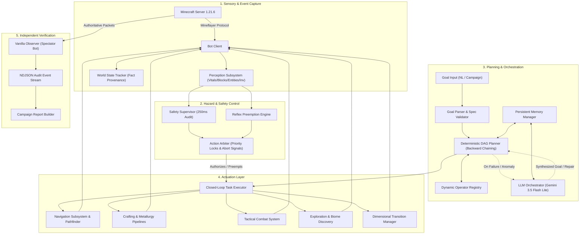
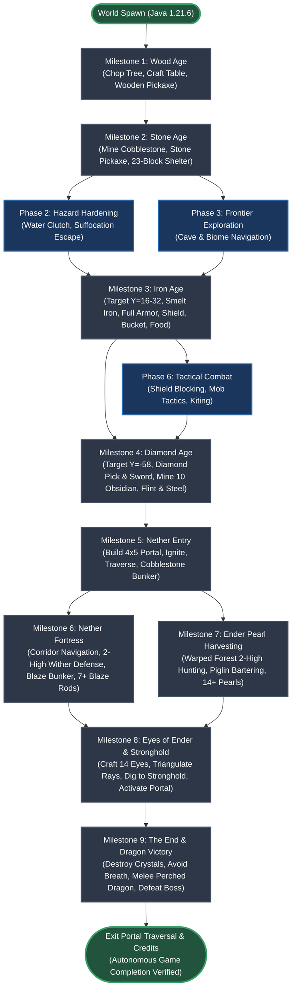

# AICRAFT FULL IMPLEMENTATION BLUEPRINT: FROM RAW SURVIVAL TO AUTONOMOUS ENDER DRAGON VICTORY

**Repository:** `1357koushik/AiCraft` (branch: `main`, target version: Minecraft Java 1.21.6, Protocol 771)  
**Execution Environment:** Windows Server / Node.js 24 / TypeScript / Mineflayer + mineflayer-pathfinder  
**LLM Engine:** Gemini 3.5 Flash Lite (`generativelanguage.googleapis.com` via OpenAI-compatible endpoint)  
**Verification Backbone:** External Vanilla Observer Spectator Bot (`tools/vanilla-observer`) + PaperMC Runner Fixtures  

---

## 1. EXECUTIVE SUMMARY AND FINAL ARCHITECTURAL VISION

The AiCraft project addresses the benchmark problem of autonomous video-game agency: taking an agent from arbitrary initial spawn in a procedurally generated Minecraft world (Java Edition 1.21.6) to defeating the Ender Dragon and safely stepping through the Exit Portal without human intervention, teleportation, operator commands, or out-of-band cheating.

### 1.1 The Dual-Engine Autonomous Paradigm
Prior attempts at autonomous Minecraft agents suffer from two complementary failure modes:
1. **Pure LLM Steering (Voyager / AutoGPT style):** Excessive reasoning latency (3 to 15 seconds per action), high inference costs, hallucinated recipe syntax, inability to navigate local geometry under combat stress, and catastrophic desynchronization during real-time tick hazards (falling gravel, lava flows, creeper ignitions).
2. **Pure Hardcoded State Machines:** Inflexibility in unexpected biomes, brittleness when terrain features block predefined macro routines, failure to recover from partial task execution (e.g., dropped items rolling down ravines), and lack of open-ended conversational adaptability.

AiCraft implements a **Dual-Engine Architecture**:
- **Deterministic Action & Planner Engine (Primary Driver):** A reactive Directed Acyclic Graph (DAG) goal resolver operating with zero token consumption and sub-millisecond planning latency. Every survival progression milestone from basic gathering (`have_wood`, `have_tool[wooden_pickaxe]`, `have_tool[stone_pickaxe]`) to advanced automation (`smelt_ore_pipeline`, `build_shelter`) resolves into deterministic task sequences backed by formal pre- and postconditions.
- **Hierarchical Safety & Reflex Arbiter:** An asynchronous interrupt system that executes ahead of both the planner and the LLM. It monitors physical vitals, environmental hazards, and active hostiles on every physics tick, triggering atomic retreats, drowning escapes, and emergency consumption without waiting for higher-level planning approval.
- **LLM High-Level Orchestrator & Anomaly Resolver (Secondary Driver):** Triggered only when the deterministic planner encounters a topological impasse, unresolved missing dependencies, open-ended player requests, or novel environmental states. The LLM acts as an executive diagnostician rather than a micro-manager, issuing structured goal adjustments that are handed right back down to the deterministic execution layer.

```
+---------------------------------------------------------------------------------------+
|                                    USER / CHAT PROMPT                                 |
+---------------------------------------------------------------------------------------+
                                           |
                                           v
+---------------------------------------------------------------------------------------+
|                               NATURAL LANGUAGE PARSER                                 |
|                         (NL -> GoalSpec with validation)                              |
+---------------------------------------------------------------------------------------+
                                           |
                                           v
+---------------------------------------------------------------------------------------+
|                             SAFETY & REFLEX ARBITER                                  |
|   - 250ms Audit Loop & Physics Tick Monitoring                                         |
|   - Preemption Hierarchy: EMERGENCY (Lava/Drown) > COMBAT > NORMAL                        |
+---------------------------------------------------------------------------------------+
                                           |
                    +----------------------+----------------------+
                    | Goal Recognized                             | Goal Unrecognized /
                    v                                             v Anomaly / Creative
+--------------------------------------+      +-----------------------------------------+
|     DETERMINISTIC DAG PLANNER        |      |       LLM EXECUTIVE ORCHESTRATOR        |
| - Recursive Backward-Chaining DAG    |      | - Gemini 3.5 Flash Lite                 |
| - Precondition Verification          |      | - Anomaly Diagnosis & Plan Synthesis    |
| - Zero LLM Latency                   |      | - Strict JSON Schema Output             |
+--------------------------------------+      +-----------------------------------------+
                    |                                             |
                    | (Task Node Pipeline)                        | (Synthesized GoalSpec)
                    v                                             |
+-------------------------------------------------------------+   |
|                    TASK EXECUTOR ENGINE                     |<--+
| - Dynamic Operator Registry                                 |
| - Closed-Loop Execution with Postcondition Assertion        |
| - Exponential Backoff & Blacklist Quarantine                |
+-------------------------------------------------------------+
                               |
                               v
+---------------------------------------------------------------------------------------+
|                               MINECRAFT SERVER (1.21.6)                               |
+---------------------------------------------------------------------------------------+
                               |
                               v
+---------------------------------------------------------------------------------------+
|                       EXTERNAL VANILLA OBSERVER (Spectator Bot)                       |
| - Independent Verification Stream (BLOCK_BREAK, PLACE, ITEM_PICKUP, etc.)            |
| - Zero Self-Reporting Bias                                                            |
+---------------------------------------------------------------------------------------+
```

### 1.2 Quantitative North Star
- **Zero Human Intervention:** Complete survival progression from initial world join to Ender Dragon defeat.
- **Strict Verification Standards:** No milestone is declared complete based on agent self-reporting. All actions must be validated by the independent `vanilla-observer` spectator bot logging server-authoritative NDJSON events.
- **Robust Execution:** Zero unhandled task arbiter deadlocks, zero unhandled death-loops from terrain hazards, and complete state persistence across crashes and disconnects.

---

## 2. REPOSITORY AUDIT

### 2.1 File-by-File Inventory and Roles

#### Core Agent Subsystem (`src/agent/`)
- `src/agent/arbiter.ts` (`ActionArbiter`): Manages exclusive execution locks. Implements priority preemption (`NORMAL` < `COMBAT_REFLEX` < `SURVIVAL_EMERGENCY`), tracking epochs and issuing abort signals to running actions.
- `src/agent/goals.ts`: Houses `DeterministicGoalResolver`, `TaskExecutor`, `parseAndValidateGoalSpec`, and inventory helpers. Compiles high-level goals (`have`, `have_tool`, `reach`, `explore`) into DAG task structures with postcondition closures.
- `src/agent/loop.ts` (`AgentController`): The primary agent loop. Executes tick cycles: Reflex -> Availability -> Observation -> Stuck Detection -> Deterministic Task vs LLM Orchestrator -> Action Execution -> Memory History Update.
- `src/agent/reflex.ts` (`ReflexLayer`): Reactive survival instincts evaluated synchronously before planning. Implements 3D BFS lava escape, drowning ascent, mob retreat, and auto-eating.
- `src/agent/stuck.ts` (`StuckDetector`): Monitors positional delta variance over time to detect pathfinding oscillations or physical traps; triggers unstuck displacement vectors.
- `src/agent/supervisor.ts` (`SafetySupervisor`): Background watchdog running a 250ms periodic audit loop alongside physics events (`health`, `breath`, `entityHurt`), preempting actions via the arbiter.

#### Action Layer (`src/actions/`)
- `src/actions/availability.ts` (`AvailabilityEngine`): Analyzes current world state and inventory to compute executable actions, enforcing execution timeouts.
- `src/actions/blacklist.ts` (`NavigationBlacklist`): Tracks unreachable coordinates and invalid blocks, applying time-decay quarantine to prevent pathfinding loops.
- `src/actions/combat.ts`: Core combat routines (`attack`, `shoot`, `flee_from_entity`).
- `src/actions/crafting.ts` (`ClosedLoopCraftingExecutor`): Handles crafting table placement, recipe matching, item production, and inventory delta postconditions.
- `src/actions/inventory_crafting.ts`: Low-level inventory manipulation (`equip`, `select_hotbar`, `swap_hands`, `craft_item`, `eat`, `smelt_items`, `smelt_ore_pipeline`, `drop_item`, `use_item`, `open_container`, `close_container`, `toss_item`).
- `src/actions/meta.ts`: Meta primitives (`wait`, `set_goal`, `idle`, `run_command` [permanently blocked by safety policy]).
- `src/actions/mining.ts`: Mining utilities (`getRequiredHarvestTier` [tiers 0-5], `techniqueMineOreVein`, `techniqueGatherSurfaceResource`, `isMatchingOreSpecies`).
- `src/actions/mining_building.ts`: High-level interactions (`dig_block`, `mine_resource`, `chop_tree`, `place_block`, `collect_items`, `collect_resource`, `build_shelter`).
- `src/actions/movement.ts`: Locomotion primitives (`goto`, `follow`, `flee`, `move`, `jump`, `swim_up`, `sprint`, `sneak`, `look_at`, `explore`, `stop`, `pillar_up`, `bridge`).
- `src/actions/navigator.ts`: Pathfinding wrappers (`navigateWithBounds`, `evaluateCandidateTarget`).
- `src/actions/registry.ts`: Action catalog containing 56 registered actions and lookup tables.
- `src/actions/shelter.ts`: Structural definitions (`ShelterBlueprint`, `SURVIVAL_SHELTER_BLUEPRINT` [3x3x3 dirt shelter, 23 blocks total], `techniqueBuildVerifiedShelter`).
- `src/actions/techniques.ts`: Compound action macros (`techniqueChopTreeFull`, `techniqueMineStaircase`, `techniqueBuildShelter`, `techniqueVacuumDrops`, `techniqueCraftPipeline`, `techniqueSmeltPipeline`).
- `src/actions/workstations.ts` (`WorkstationOwnershipRegistry`): Tracks bot-placed crafting tables and furnaces to prevent workstation abandonment.
- `src/actions/world_interaction.ts`: Environment interactions (`use_block`, `interact`, `sleep`, `set_time`, `set_weather`).

#### Perception Subsystem (`src/perception/`)
- `src/perception/blocks.ts` (`BlockScanner`): Identifies notable blocks, environmental hazards (lava, void, open water), and terrain walkability.
- `src/perception/entities.ts` (`EntityPerception`): Analyzes nearby entities, hostile status, line of sight, and distances.
- `src/perception/index.ts` (`buildObservation`): Assembles complete environmental snapshots for LLM and planner consumption.
- `src/perception/inventory.ts` (`InventoryPerception`): Aggregates main inventory, computes tool tiers, and derives instantaneous craftability.
- `src/perception/vitals.ts` (`VitalPerception`): Tracks health, hunger, oxygen, status effects (burning, freezing), and attack cooldowns.
- `src/perception/world_state.ts` (`WorldStateTracker`): Event-driven reducer updating tracked world facts on `blockUpdate`, `entitySpawn`, `entityDespawn`, and `entityMove`.

#### Campaign and Testing Subsystem (`src/campaign/` & `src/runner/`)
- `src/campaign/orchestrator.ts`: Connects agent and observer bots, coordinating multi-scenario benchmark campaigns.
- `src/campaign/provenance.ts`: Captures environment state (git commit, config hash, server settings) for experiment provenance.
- `src/campaign/scenarios_builder.ts`: Defines 17 test scenario families across 1,954 lines of code.
- `src/campaign/types.ts`: Type contracts for test reports, defect logs, and campaign summaries.
- `src/runner/`: Test harness containing `IntegrationScenarioRunner`, `VanillaBridgeClient`, `DisposableFixtureManager`, and execution watchdogs.
- `tools/vanilla-observer/`: External spectator bot querying server events via HTTP and NDJSON streams.

### 2.2 Evidence Quality Analysis

| Capability / Component | Evidence Quality | Validation Details and Found Inconsistencies |
|---|---|---|
| Bot Connection & Auto-Reconnect | **LIVE_PASS** | Validated via `ConnectionManager` with exponential backoff on Java 1.21.6 server. |
| Milestone 1: Wood Age (`wooden_pickaxe`) | **LIVE_PASS** | Fully validated in `logs/survival/milestone_01_wood_tools.json`. Verified tree chopping, plank crafting, stick crafting, and crafting table mechanics. |
| Milestone 2: Stone Age (`stone_pickaxe`) | **LIVE_PASS** | Fully validated in `logs/survival/milestone_02_stone_age.json`. Observer verified 4 stone blocks broken with wooden pickaxe and subsequent stone pickaxe crafting. |
| Milestone 2: Survival Shelter Placement | **DEFECT (MOCK_ONLY)** | **CRITICAL DEFECT:** `milestone_02_stone_age.md` reports PASS, but observer logs confirm only 3 blocks placed instead of the 23 blocks specified in `SURVIVAL_SHELTER_BLUEPRINT`. The test assertion accepted `placed >= 3` instead of verifying full shelter completion. |
| Smelting Pipelines (`smelt_items`, `smelt_ore_pipeline`) | **LIVE_PASS** | Validated in integration campaign run `campaign_1792732057464`. Successfully placed furnace, fueled with wood/coal, and smelted raw ores. |
| 56 Base Action Contracts | **UNIT_ONLY** | Tested across 29 test files and 343 vitest tests. Live server execution not validated outside of specific scenario families. |
| Deterministic Goal Resolver (`goals.ts`) | **UNIT_ONLY** | Handcoded solely for `have`, `reach`, `explore`, and pickaxes (`wooden_pickaxe`, `stone_pickaxe`). Completely lacks resolution logic for iron, diamond, nether, or combat goals. |
| Reactive Safety Supervisor & Reflex Layer | **UNIT_ONLY** | Tested via mock bot instances in `reflex.test.ts` and `supervisor.test.ts`. Live performance under severe server tick lag remains unverified. |
| Navigation Blacklist & Dynamic Quarantine | **UNIT_ONLY** | Validated via `navigation_reliability.test.ts`. Live evasion of complex multi-tier terrain traps needs further verification. |
| Nether / End / Boss Progression | **NOT_IMPLEMENTED** | Zero implementation across all repository files. |

---

## 3. EXISTING VS MISSING CAPABILITIES TABLE

| Progression Domain | Feature / Capability | Existing Implementation | Defect / Architectural Gap | Target Resolution Phase |
|---|---|---|---|---|
| **Core Architecture** | Goal DAG Resolution | Hand-coded `switch` statement in `goals.ts` | Non-scalable: adding an item requires writing custom DAG nodes manually. | Phase 1 |
| **Core Architecture** | Shelter Construction | `techniqueBuildShelter` in `techniques.ts` | **Defect:** Halts after 3 blocks due to strict obstacle collision checks, passing false positive test. | Phase 0 |
| **Perception & Safety**| Environmental Hazard Reflex | Lava BFS escape & Drowning escape in `reflex.ts` | Lacks water-bucket clutch, gravel suffocation handling, and blast evasion. | Phase 2 |
| **Navigation** | Systematic Spatial Exploration | Random cardinal `explore` in `movement.ts` | Lacks chunk coverage tracking, cave pathfinding, and landmark navigation. | Phase 3 |
| **Memory** | Session Continuity & Plan Reuse | World-keyed JSON persistence in `memory/` | No mid-campaign failure recovery; no plan caching or execution cost metrics. | Phase 4 |
| **Smelting & Metals** | Iron Metallurgy & Toolset | `smelt_ore_pipeline` exists as raw action | Missing high-level goal DAG for iron tools, iron armor, buckets, and shields. | Phase 5 |
| **Survival Sustenance**| Sustained Food Production | Basic auto-eat in `reflex.ts` | No agriculture, animal husbandry, cooking, or food caching pipelines. | Phase 5 |
| **Combat** | Hostile Engagement Tactics | Raw `attack` action in `combat.ts` | No shield blocking, ranged bow mechanics, or mob-specific tactical routines. | Phase 6 |
| **Mining** | Deepslate Diamond Extraction | Vein mining in `mining.ts` | Lacks branch mining, deepslate navigation, and lava pocket defense. | Phase 7 |
| **Nether Dimension** | Portal Fabrication | None | Lacks obsidian extraction, casted lava mold techniques, and portal ignition. | Phase 8 |
| **Nether Dimension** | Fortress Navigation & Blazes | None | Lacks fortress search algorithms, wither evasion, and blaze farming routines. | Phase 9 |
| **The End Gateway** | Ender Pearl Acquisition | None | Lacks warped forest Enderman hunting routines and Piglin bartering pipelines. | Phase 10 |
| **The End Gateway** | Stronghold Triangulation | None | Lacks Eye of Ender throwing, vector intersection math, and portal room search. | Phase 11 |
| **Boss Combat** | Ender Dragon Execution | None | Lacks crystal destruction, perch timing, breath evasion, and fountain combat. | Phase 12 |
| **System Reliability**| Autonomous Multi-Seed Campaign| Basic campaign orchestrator in `campaign/` | No automated recovery from bot death, bed respawning, or multi-seed evaluation. | Phase 13 |

---

## 4. TARGET ARCHITECTURE: 13 CORE SUBSYSTEMS

```
                                  +---------------------------------------+
                                  |     12. LLM HIGH-LEVEL ORCHESTRATOR    |
                                  |  - Gemini 3.5 Flash Lite Anomaly Fix  |
                                  +---------------------------------------+
                                                      ^
                                                      | Replanning / Unstick
                                                      v
+-------------------------------+  State   +---------------------------------------+  Goals  +-------------------------------------+
| 3. PERCEPTION & SENSORY ENGINE|--------->| 4. WORLD STATE & FACT TRACKER         |-------->| 7. DETERMINISTIC DAG PLANNER        |
| - BlockScanner, Vitals        |          | - Event Reducer, Provenance Store     |         | - Recursive Backward-Chaining Engine|
+-------------------------------+          +---------------------------------------+         +-------------------------------------+
                |                                             |                                                 |
                v                                             v                                                 v
+-------------------------------+          +---------------------------------------+         +-------------------------------------+
| 2. SAFETY SUPERVISOR (250ms)  |          | 10. EXPLORATION & SPATIAL ENGINE      |         | 6. DYNAMIC OPERATOR REGISTRY        |
| - Invariant & Hazard Auditing |          | - Frontier Exploration, Cave Mapper   |         | - Contract Schema, Dependency Rules |
+-------------------------------+          +---------------------------------------+         +-------------------------------------+
                |                                             |                                                 |
                v Preemption                                  | Locomotion Vectors                              v Atomic Tasks
+-------------------------------+                             v                                      +-------------------------------------+
| 1. REFLEX & EMERGENCY ARBITER |------------------------------------------------------------------->| 8. CLOSED-LOOP TASK EXECUTOR        |
| - Priority Lock & Abort Engine|                                                                    | - Pre/Post Condition Verification   |
+-------------------------------+                                                                    +-------------------------------------+
                |                                                                                                       |
                | Low-level Hardware Interrupt                                                                          | Actuator Commands
                \---------------------------------------------+---------------------------------------------------------/
                                                              |
                                                              v
                                           +---------------------------------------+
                                           | 5. NAVIGATION & LOCOMOTION ENGINE     |
                                           | - Pathfinder, Blacklist, Physics Move |
                                           +---------------------------------------+
                                                              |
                                                              v
                                           +---------------------------------------+
                                           |        MINECRAFT BOT (Mineflayer)     |
                                           +---------------------------------------+
                                                              |
                              +-------------------------------+-------------------------------+
                              |                                                               |
                              v                                                               v
              +-------------------------------+                               +-------------------------------+
              | 9. TACTICAL COMBAT SUBSYSTEM  |                               | 11. DIMENSIONAL TRANSITION MGR|
              | - Shield/Kite/Target Tracking |                               | - Nether/End Portals & Physics|
              +-------------------------------+                               +-------------------------------+
                                                              |
                                                              v
                                              +-------------------------------+
                                              | 13. CAMPAIGN OBSERVER SYSTEM  |
                                              | - Spectator Bot, NDJSON Stream|
                                              +-------------------------------+
```

### Component 1: Reflex & Emergency Preemption Engine
- **Files:** `src/agent/reflex.ts`, `src/agent/arbiter.ts`
- **Responsibilities:** Executes sub-tick emergency actions. Operates ahead of all planning loops.
- **Interfaces & Methods:**
  ```typescript
  interface IReflexEngine {
    evaluateEmergency(bot: Bot): EmergencyAction | null;
    executePreemption(emergency: EmergencyAction, arbiter: ActionArbiter): Promise<void>;
  }
  ```
- **Data Flow:** Consumes raw bot physics signals (`bot.entity.position`, `bot.entity.velocity`, `bot.oxygenLevel`, `inLava`). Emits `ABORT` signals to current task tokens in `ActionArbiter` and locks execution to emergency routines (`water_clutch`, `lava_scramble`, `drown_ascend`).

### Component 2: Safety Supervisor & Audit Loop
- **Files:** `src/agent/supervisor.ts`, `src/safety/index.ts`, `src/safety/survival_policy.ts`
- **Responsibilities:** Evaluates invariants at 250ms intervals. Ensures the bot does not drift into hazard zones, consume harmful items, or violate structural safety limits.
- **Interfaces & Methods:**
  ```typescript
  interface ISafetySupervisor {
    startAuditLoop(intervalMs: number): void;
    validateAction(action: ActionDef, params: Record<string, any>): SafetyValidationResult;
  }
  ```
- **Data Flow:** Intercepts proposed actions from `TaskExecutor`. Queries `BlockScanner` and `VitalPerception`. If an action violates constraints (e.g. attempting to dig directly downwards into uninspected voxels), rejects execution with `SafetyViolationError`.

### Component 3: Perception & Sensory Reduction Subsystem
- **Files:** `src/perception/blocks.ts`, `src/perception/entities.ts`, `src/perception/inventory.ts`, `src/perception/vitals.ts`, `src/perception/index.ts`
- **Responsibilities:** Transforms raw Mineflayer object graphs into immutable, serializable, and diffable data structures (`Observation`).
- **Interfaces & Methods:**
  ```typescript
  interface IPendingObservation {
    vitals: VitalsState;
    position: PositionState;
    inventory: InventorySummary;
    entities: EntityPerceptionSummary;
    blocks: NotableBlocksSummary;
    timestamp: number;
  }
  function buildObservation(bot: Bot): IPendingObservation;
  ```
- **Data Flow:** Samples chunk octrees, inventory slots, and entity stores; produces high-density summaries for the DAG planner and LLM prompt builder.

### Component 4: World State Tracker & Fact Provenance Engine
- **Files:** `src/perception/world_state.ts`, `src/memory/index.ts`
- **Responsibilities:** Maintains an append-only timeline of world facts with provenance tags (e.g. `CHEST_PLACED`, `FURNACE_LOCATED`, `BED_SPAWN_SET`).
- **Interfaces & Methods:**
  ```typescript
  interface IWorldStateTracker {
    registerEvent(event: WorldStateEvent): void;
    queryFact<T>(predicate: (fact: FactRecord) => boolean): T | null;
    snapshot(): WorldStateSnapshot;
  }
  ```
- **Data Flow:** Listens to `blockUpdate`, `entitySpawn`, and container events. Emits spatial landmarks to `MemoryManager`.

### Component 5: Navigation & Locomotion Subsystem
- **Files:** `src/actions/movement.ts`, `src/actions/navigator.ts`, `src/actions/blacklist.ts`
- **Responsibilities:** Manages complex 3D traversal across changing terrain, dynamic obstacle avoidance, bridging, and pillar mechanics.
- **Interfaces & Methods:**
  ```typescript
  interface INavigationSubsystem {
    navigateTo(goal: Vec3, options: NavOptions): Promise<NavigationResult>;
    blacklistCoordinate(pos: Vec3, reason: BlacklistReason, ttlMs: number): void;
    isQuarantined(pos: Vec3): boolean;
  }
  ```
- **Data Flow:** Wraps `mineflayer-pathfinder` with heuristic validation. Records pathfinding failures to `NavigationBlacklist`, returning alternate navigation vectors.

### Component 6: Dynamic Operator Registry & Prerequisite Engine
- **Files:** `src/actions/registry.ts`, `src/contracts/`
- **Responsibilities:** Declares atomic operators along with their preconditions, cost functions, inventory deltas, and verification closures.
- **Interfaces & Methods:**
  ```typescript
  interface IOperator<TParams = any> {
    id: string;
    preconditions: (state: WorldStateSnapshot, inv: InventorySummary) => boolean;
    cost: (state: WorldStateSnapshot) => number;
    execute: (bot: Bot, params: TParams, signal: AbortSignal) => Promise<ExecutionResult>;
    postconditions: (bot: Bot) => Promise<boolean>;
  }
  ```
- **Data Flow:** Supplies operator definitions to `DeterministicGoalResolver` and `TaskExecutor`.

### Component 7: Deterministic DAG Planner & Closed-Loop Task Executor
- **Files:** `src/agent/goals.ts`
- **Responsibilities:** Resolves goal states into dependency DAGs via recursive backward chaining without invoking the LLM.
- **Interfaces & Methods:**
  ```typescript
  interface IGoalPlanner {
    buildPlan(goal: GoalSpec, world: WorldStateSnapshot): TaskPlan;
  }
  interface ITaskExecutor {
    executePlan(plan: TaskPlan, context: ExecutionContext): Promise<PlanExecutionResult>;
  }
  ```
- **Data Flow:** Receives a target `GoalSpec` (e.g. `{ kind: 'have_item', item: 'iron_pickaxe', count: 1 }`). Recursively resolves prerequisites down to atomic actions (`mine_block`, `craft_item`), producing an executable topological graph.

### Component 8: Closed-Loop Resource & Crafting Pipeline
- **Files:** `src/actions/crafting.ts`, `src/actions/inventory_crafting.ts`, `src/actions/techniques.ts`, `src/actions/workstations.ts`
- **Responsibilities:** Manages tool and workstation lifecycles. Automates furnace fueling, recipe assembly, and drop vacuuming.
- **Interfaces & Methods:**
  ```typescript
  interface ICraftingPipeline {
    craftItem(item: string, count: number): Promise<boolean>;
    smeltItem(input: string, output: string, count: number): Promise<boolean>;
  }
  ```
- **Data Flow:** Dispatches bot movements to workstations, opens container windows, validates input counts, tracks burn timers, and collects output products.

### Component 9: Tactical Combat Subsystem
- **Files:** `src/actions/combat.ts`, new combat controllers
- **Responsibilities:** Manages real-time combat behaviors: weapon swapping, shield blocking, strafing, kiting, and ranged weapon targeting.
- **Interfaces & Methods:**
  ```typescript
  interface ITacticalCombatSystem {
    engageTarget(entity: Entity, strategy: CombatStrategy): Promise<CombatOutcome>;
    defendAgainstProjectile(projectile: Entity): void;
  }
  ```
- **Data Flow:** Subscribes to entity movement packets; tracks mob animations (e.g. creeper swelling, skeleton draw); synchronizes shield deployment and weapon swings.

### Component 10: Environmental & Biome Exploration Subsystem
- **Files:** `src/actions/movement.ts`, new spatial discovery modules
- **Responsibilities:** Coordinates chunk exploration, cave navigation, and landmark identification (e.g. villages, exposed ravines, ocean ruins).
- **Interfaces & Methods:**
  ```typescript
  interface IExplorationManager {
    findUnexploredChunk(biomePreference?: string[]): Promise<ChunkCoordinate>;
    locateStructure(structureType: StructureType): Promise<Vec3 | null>;
  }
  ```
- **Data Flow:** Analyzes loaded chunks from `BlockScanner`, calculates frontier exploration coordinates, and registers discovered biomes into `MemoryManager`.

### Component 11: Dimension Gateways & Extradimensional Navigation
- **Files:** New dimension management modules
- **Responsibilities:** Manages portal construction, dimension transitions, coordinate translation ($1:8$ Nether scale), and dimension-specific navigation mechanics.
- **Interfaces & Methods:**
  ```typescript
  interface IDimensionalManager {
    buildNetherPortal(anchor: Vec3): Promise<boolean>;
    traverseDimension(targetDimension: 'overworld' | 'the_nether' | 'the_end'): Promise<boolean>;
  }
  ```
- **Data Flow:** Detects portal entry events, handles loading screens, suppresses pathfinding timeouts across dimension transitions, and updates dimension-specific world maps.

### Component 12: LLM High-Level Orchestrator & Anomaly Resolver
- **Files:** `src/agent/loop.ts`, `src/prompt/builder.ts`, `src/llm/`
- **Responsibilities:** Provides high-level diagnostics and contingency planning when deterministic routines fail or ambiguous player goals are received.
- **Interfaces & Methods:**
  ```typescript
  interface ILLMOrchestrator {
    diagnoseAnomaly(failure: TaskExecutionFailure, context: IPendingObservation): Promise<PlanRepairDirective>;
  }
  ```
- **Data Flow:** Formats environmental observations and failure diagnostics into structured prompts for Gemini 3.5 Flash Lite; validates and translates the returned JSON into updated `GoalSpec` directives.

### Component 13: Campaign Observer & Verification Infrastructure
- **Files:** `src/campaign/`, `src/runner/`, `tools/vanilla-observer/`
- **Responsibilities:** Independent test harness that records external server events, tracks milestone criteria, and computes quantitative reliability metrics.
- **Interfaces & Methods:**
  ```typescript
  interface ICampaignObserver {
    assertEvent(eventType: string, matcher: (event: any) => boolean, timeoutMs: number): Promise<boolean>;
    generateCampaignReport(): CampaignSummaryReport;
  }
  ```
- **Data Flow:** The external spectator bot consumes the server event stream, verifies block place/break actions and inventory changes, and writes NDJSON audit records to disk.

---

## 5. ARCHITECTURE DEPENDENCY GRAPH



---

## 6. COMPLETE PHASED IMPLEMENTATION ROADMAP

### Phase 0: Evidence Reconciliation and Foundation Hardening
- **Problem Solved:** Resolves false-positive milestone evaluations and inconsistent contract assertions. Specifically fixes the shelter placement defect (`milestone_02_stone_age.md` accepted 3 blocks placed instead of the 23 blocks required by `SURVIVAL_SHELTER_BLUEPRINT`) and synchronizes action contracts.
- **Repository Components:** `src/actions/shelter.ts`, `src/actions/techniques.ts`, `src/actions/mining_building.ts`, `tests/shelter_blueprint.test.ts`, `src/contracts/`
- **Files to Add/Change/Deprecate:**
  - Modify: `src/actions/shelter.ts` (enforce 23-block placement and clearance verification).
  - Modify: `src/actions/techniques.ts` (`techniqueBuildShelter`: add collision clearing and strict count assertions).
  - Modify: `tests/shelter_blueprint.test.ts` (assert full 23-block geometry verification).
  - Modify: `src/contracts/action_contract_manifest.json` (update action status flags to match current capabilities).
- **Architectural Decisions & Data Contracts:**
  ```typescript
  interface ShelterBuildResult {
    success: boolean;
    blocksPlaced: number;
    expectedBlocks: number;
    missingCoordinates: Vec3[];
    unobstructedInterior: boolean;
  }
  ```
- **Implementation Tasks:**
  1. Update `SURVIVAL_SHELTER_BLUEPRINT` in `shelter.ts` to include clear bounding box dimensions, entry coordinates, and torch placement offsets.
  2. Rewrite `techniqueBuildShelter` in `techniques.ts`: clear internal brush/vegetation before building; verify each block placement with the observer.
  3. Fix test assertions in `tests/shelter_blueprint.test.ts` to require 100% blueprint completion ($23/23$ blocks).
  4. Audit `src/contracts/action_contract_manifest.json` against actual test coverage, standardizing status flags across all 56 actions.
- **Required Tests:**
  - Unit: `tests/shelter_blueprint.test.ts` passing with 23 blocks verified.
  - Integration: `src/runner/scenarios/` shelter test asserting all 23 block placements via `DisposableFixtureManager`.
  - Live: Rerun Milestone 2 campaign; verify external observer records $\ge 23$ `BLOCK_PLACE` events for shelter coordinates.
- **Acceptance Criteria:** Observer logs confirm 23 contiguous solid blocks placed surrounding a 1x1x2 interior space with an accessible entrance, passing with zero errors.
- **Failure Cases & Safety:** Clear obstructions before building; if target space is blocked by bedrock or unmineable obstacles, translate the target origin and retry.
- **Dependencies:** None.
- **Definition of Done:** Milestone 2 passes with 23 verified block placements in server-authoritative observer logs; unit test suite passes with 0 failures.
- **Expected Git Commits:**
  - `fix(shelter): enforce 23-block survival blueprint verification`
  - `test(shelter): add strict geometry validation to unit and scenario suites`
  - `chore(contracts): align action contract manifest with real test status`
- **What Next Phase Can Assume:** Blueprint construction actions accurately reflect physical block placements on the server.

---

### Phase 1: Generic Operator Registry and Dynamic DAG Planner
- **Problem Solved:** Replaces the hand-coded `switch` statement in `goals.ts` with a recursive backward-chaining DAG planner. Enables dynamic resolution for arbitrary items (`iron_pickaxe`, `iron_sword`, `iron_armor`, `furnace`, etc.) without writing manual resolver cases.
- **Repository Components:** `src/agent/goals.ts`, `src/actions/registry.ts`, `src/types/index.ts`, `src/actions/inventory_crafting.ts`
- **Files to Add/Change/Deprecate:**
  - Add: `src/agent/planner/operator.ts` (abstract operator definitions).
  - Add: `src/agent/planner/dag.ts` (backward-chaining dependency graph compiler).
  - Modify: `src/agent/goals.ts` (integrate the dynamic DAG planner into `DeterministicGoalResolver`).
  - Modify: `src/types/index.ts` (add `OperatorContract`, `PlanStepNode`, `GoalCondition` types).
  - Deprecate: Hardcoded goal branching logic in `goals.ts`.
- **Architectural Decisions & Data Contracts:**
  ```typescript
  interface IOperatorDefinition<TParams = any> {
    id: string;
    producedItems: Array<{ item: string; count: number }>;
    requiredTools: Array<{ toolType: string; minTier: number }>;
    consumedItems: Array<{ item: string; count: number }>;
    environmentalPreconditions: Array<(world: WorldStateSnapshot) => boolean>;
    estimateCost: (world: WorldStateSnapshot, inv: InventorySummary) => number;
    execute: (bot: Bot, params: TParams, signal: AbortSignal) => Promise<boolean>;
  }
  ```
- **Implementation Tasks:**
  1. Define the `IOperatorDefinition` schema and register atomic operators for gathering, crafting, and smelting.
  2. Implement a backward-chaining DAG resolution algorithm: given a target item, recursively resolve missing ingredients down to available inventory or harvestable resources.
  3. Integrate cycle detection and topological sorting into `dag.ts`.
  4. Connect the compiled DAG execution sequence to `TaskExecutor`.
- **Required Tests:**
  - Unit: `tests/dynamic_dag_planner.test.ts` testing plan generation for `stone_pickaxe`, `iron_pickaxe`, and `furnace`.
  - Integration: End-to-end plan execution with a mocked bot, verifying topological execution order.
  - Live: Issue the goal `have: iron_pickaxe: 1` on a live server; verify automated progression through wood, stone, furnace, iron ore, and final crafting.
- **Acceptance Criteria:** Given an empty inventory in a survival world, the planner generates and executes a plan producing an `iron_pickaxe` within 180 seconds.
- **Failure Cases & Safety:** Detect and reject impossible resource chains (e.g. attempting to mine diamond without an iron pickaxe in inventory or reachable nearby).
- **Dependencies:** Phase 0.
- **Definition of Done:** All basic tools and workstations (`wooden_pickaxe`, `stone_pickaxe`, `iron_pickaxe`, `furnace`, `crafting_table`) resolve dynamically through the operator graph without custom code paths.
- **Expected Git Commits:**
  - `feat(planner): implement backward-chaining dynamic DAG compiler`
  - `feat(operators): define base operator set for gathering, crafting, and smelting`
  - `refactor(goals): migrate DeterministicGoalResolver to use dynamic operator DAG`
- **What Next Phase Can Assume:** Any registered recipe or tool progression can be targeted by a high-level goal and resolved into an executable DAG plan.

---

### Phase 2: Reactive Hazard and Survival Control Hardening
- **Problem Solved:** Prevents bot deaths from falling, gravel/sand suffocation, and close-range creeper detonations during automated routines.
- **Repository Components:** `src/agent/reflex.ts`, `src/agent/supervisor.ts`, `src/actions/movement.ts`, `src/perception/vitals.ts`
- **Files to Add/Change/Deprecate:**
  - Modify: `src/agent/reflex.ts` (implement `water_bucket_clutch`, suffocation burrowing, and blast retreat).
  - Modify: `src/agent/supervisor.ts` (add fall velocity and suffocating block detection to the 250ms audit loop).
  - Add: `src/actions/hazards.ts` (emergency reaction techniques).
- **Architectural Decisions & Data Contracts:**
  ```typescript
  interface HazardSignal {
    type: 'FREE_FALL' | 'SUFFOCATION' | 'EXPLOSION_IMMINENT' | 'LAVA_IMMERSED';
    severity: 'WARNING' | 'CRITICAL' | 'FATAL';
    sourceEntity?: Entity;
    sourceBlock?: Vec3;
    recommendedAction: 'CLUTCH_WATER' | 'DIG_OUT' | 'SHIELD_DEPLOY' | 'SPRINT_RETREAT';
  }
  ```
- **Implementation Tasks:**
  1. Add a free-fall detection hook in `reflex.ts` monitoring negative Y velocity; deploy a water bucket onto the target ground block when fall distance exceeds 4 blocks.
  2. Implement suffocation detection: if the bot's head shares coordinates with solid gravel or sand, immediately mine out the obstructing block.
  3. Implement explosive threat reactions: monitor creeper fuse states (`ignited` / swelling); immediately raise shield or sprint backward outside the explosion radius.
- **Required Tests:**
  - Unit: `tests/hazard_reflexes.test.ts` validating fall detection calculations and suffocation reactions against mock states.
  - Live: Use `DisposableFixtureManager` to drop the bot from a 15-block height; assert that `water_bucket_clutch` triggers and the bot survives without fall damage.
- **Acceptance Criteria:** 100% survival rate across 20 consecutive 15-block fall tests using water bucket clutching.
- **Failure Cases & Safety:** If no water bucket is equipped, search hotbar slots immediately; if none available, attempt to steer toward water pools or soft landing sites.
- **Dependencies:** Phase 0, Phase 1.
- **Definition of Done:** Bot survives standard free-fall and suffocation hazards during unattended survival runs.
- **Expected Git Commits:**
  - `feat(reflex): add water bucket clutch mechanics for fall damage prevention`
  - `feat(safety): add gravel and sand suffocation escape routines`
  - `feat(defense): implement reactive creeper blast evasion and shield blocking`
- **What Next Phase Can Assume:** The bot handles sudden physical hazards without dying or crashing the main control loop.

---

### Phase 3: Exploration, Navigation, and Environmental Reasoning
- **Problem Solved:** Replaces blind random-direction movement (`explore`) with systematic chunk frontier exploration, cave navigation, and terrain topology mapping.
- **Repository Components:** `src/actions/movement.ts`, `src/actions/navigator.ts`, `src/perception/blocks.ts`, `src/memory/index.ts`
- **Files to Add/Change/Deprecate:**
  - Add: `src/actions/exploration/frontier.ts` (frontier-based chunk exploration algorithm).
  - Add: `src/actions/exploration/cave_traversal.ts` (3D cave pathing and torch placement).
  - Modify: `src/actions/movement.ts` (replace random `explore` with frontier-guided navigation).
  - Modify: `src/memory/index.ts` (record visited chunk grids and discovered landmarks).
- **Architectural Decisions & Data Contracts:**
  ```typescript
  interface IExplorationGrid {
    chunkStatus: Map<string, 'UNEXPLORED' | 'MAPPED' | 'EXHAUSTED'>;
    detectedBiomes: Map<string, string>;
    knownOreExposures: Map<string, Vec3[]>;
    getNextFrontier(origin: Vec3, preferredBiome?: string): Vec3;
  }
  ```
- **Implementation Tasks:**
  1. Implement a 2D chunk grid tracker inside `frontier.ts` recording explored chunk coordinates.
  2. Implement frontier target calculation: identify boundary chunks adjacent to ungenerated/unobserved regions.
  3. Implement a cave traversal routine that monitors light levels, places torches when light drops below threshold ($< 4$), and navigates descending branches.
  4. Connect discovered resource locations (e.g. exposed iron/coal veins) to `MemoryManager`.
- **Required Tests:**
  - Unit: `tests/frontier_exploration.test.ts` verifying path selection toward unmapped coordinates.
  - Integration: Simulate a 10-chunk obstacle course; assert the bot maps all sectors without entering infinite navigation loops.
  - Live: Command `explore: 500m`; verify the bot travels 500 blocks away from origin while mapping landmarks and sustaining food levels.
- **Acceptance Criteria:** Bot systematically navigates across 500 blocks of unmapped terrain, discovering at least 2 distinct biomes without getting stuck in terrain obstacles.
- **Failure Cases & Safety:** Prevent entering unlit ravines without bridging materials; blackhole-quarantine chunks identified as sheer drops or deep ocean.
- **Dependencies:** Phase 1, Phase 2.
- **Definition of Done:** The agent systematically discovers and logs landmarks, biomes, and surface caves across wide operational radii.
- **Expected Git Commits:**
  - `feat(explore): implement frontier-based chunk exploration engine`
  - `feat(nav): add autonomous cave exploration with automated torch lighting`
  - `feat(memory): record explored biomes and resource landmarks to persistent store`
- **What Next Phase Can Assume:** The agent can navigate toward distant target coordinates and discover specific biomes or caves on demand.

---

### Phase 4: Persistent Memory and Validated Plan Reuse
- **Problem Solved:** Retains learned knowledge (known workstations, ore veins, death locations, shelter coordinates) across restarts, and tracks plan execution costs to optimize future goal resolutions.
- **Repository Components:** `src/memory/index.ts`, `src/agent/loop.ts`, `src/agent/goals.ts`
- **Files to Add/Change/Deprecate:**
  - Modify: `src/memory/index.ts` (implement schema migrations, plan cache, and performance metric tracking).
  - Add: `src/memory/plan_cache.ts` (caches validated DAG execution paths).
  - Modify: `src/agent/loop.ts` (persist agent state on graceful disconnect and periodic autosave).
- **Architectural Decisions & Data Contracts:**
  ```typescript
  interface IPlanCacheEntry {
    goalHash: string;
    successfulDAG: TaskPlan;
    averageExecutionDurationMs: number;
    resourceYieldRatio: number;
    failureCount: number;
  }
  ```
- **Implementation Tasks:**
  1. Expand `data/memory-{world}.json` schema to include plan performance histories and workstation ownership tables.
  2. Implement `PlanCache`: check for previously successful plans before compiling new DAGs from scratch.
  3. Track execution costs (time taken, durability expended, health lost) per operator.
  4. Implement an autosave flush routine triggering every 60 seconds and on process shutdown.
- **Required Tests:**
  - Unit: `tests/plan_cache.test.ts` verifying plan storage, retrieval, and cache invalidation when environmental conditions change.
  - Integration: Execute a goal, simulate a process restart, and verify the bot resumes operational awareness and recognizes existing workstations.
- **Acceptance Criteria:** Following a process kill and restart, the bot identifies its previously placed crafting table and resumes goal execution without duplicate crafting.
- **Failure Cases & Safety:** Validate memory integrity on load; if JSON parsing fails or corrupts, quarantine the corrupted file and rebuild state from real-time sensory observation.
- **Dependencies:** Phase 1, Phase 3.
- **Definition of Done:** Persistent memory preserves world landmarks, tool caches, and plan performance metrics across process restarts.
- **Expected Git Commits:**
  - `feat(memory): add plan execution cache with cost optimization tracking`
  - `feat(memory): implement robust state recovery and world-key migration`
  - `feat(agent): integrate periodic state autosave into core agent loop`
- **What Next Phase Can Assume:** Workstation coordinates, resource locations, and execution metrics persist reliably across restarts.

---

### Phase 5: Iron Age and Mid-game Progression
- **Problem Solved:** Automates the complete mid-game progression loop: mining raw iron and coal, crafting and running furnaces, producing full iron armor, crafting buckets and shields, and establishing a sustainable cooked food supply.
- **Repository Components:** `src/actions/mining.ts`, `src/actions/crafting.ts`, `src/actions/inventory_crafting.ts`, `src/actions/techniques.ts`, `src/actions/workstations.ts`
- **Files to Add/Change/Deprecate:**
  - Add: `src/actions/farming/food_pipeline.ts` (hunting, harvesting, and furnace cooking).
  - Add: `src/actions/equipment/armor_manager.ts` (armor crafting, durability monitoring, and auto-equipping).
  - Modify: `src/actions/techniques.ts` (add `techniqueAutomateIronSmeltCycle`).
  - Modify: `src/actions/mining.ts` (prioritize Y-levels 16 through 32 for optimal iron ore extraction).
- **Architectural Decisions & Data Contracts:**
  ```typescript
  interface MidGameInventoryTarget {
    armor: { helmet: boolean; chestplate: boolean; leggings: boolean; boots: boolean };
    tools: { pickaxe: 'iron'; sword: 'iron'; shield: boolean; waterBucket: boolean };
    foodCount: number; // cooked beef, porkchops, or bread
  }
  ```
- **Implementation Tasks:**
  1. Implement automated staircase mining targeting Y-levels 16 through 32 to harvest raw iron ore.
  2. Build a closed-loop smelting manager: place furnace, insert coal or wood fuel, smelt raw iron, and retrieve iron ingots.
  3. Implement an armor manager: check missing armor slots, craft corresponding iron armor pieces, and auto-equip them.
  4. Implement shield and bucket crafting pipelines.
  5. Implement food acquisition: hunt nearby animals (cows, pigs, sheep), smelt raw meat in the furnace, and maintain a reserve of at least 16 cooked food items.
- **Required Tests:**
  - Unit: `tests/iron_progression.test.ts` verifying DAG resolution for full iron gear.
  - Live: From a fresh world with basic stone tools, issue goal `achieve: iron_age`; verify the bot gathers iron ore, smelts ingots, crafts full iron armor + shield + bucket, and equips them on a live server.
- **Acceptance Criteria:** Bot crafts and equips a complete iron armor set, iron sword, iron pickaxe, shield, and water bucket, with $\ge 16$ cooked food items in inventory, within 25 minutes from spawn.
- **Failure Cases & Safety:** Never dig straight down into unexplored voxels; place torches during staircase mining; maintain escape routes out of mine shafts.
- **Dependencies:** Phase 1, Phase 2, Phase 4.
- **Definition of Done:** Agent independently equips full iron armor, iron tools, shield, bucket, and food supply on a live vanilla server.
- **Expected Git Commits:**
  - `feat(mining): add targeted iron vein mining at optimal Y-levels`
  - `feat(crafting): implement automated iron smelting and armor crafting manager`
  - `feat(survival): add animal harvesting and automated furnace cooking pipeline`
- **What Next Phase Can Assume:** The bot possesses high defense (full iron armor + shield), fall recovery capability (water bucket), and stable food reserves.

---

### Phase 6: Combat and Hostile Mob Handling
- **Problem Solved:** Enables robust survival during night cycles and underground encounters through reactive combat tactics: shield blocking, weapon swapping, tactical retreats, and mob-specific engagement strategies.
- **Repository Components:** `src/actions/combat.ts`, `src/agent/reflex.ts`, `src/perception/entities.ts`, `src/agent/supervisor.ts`
- **Files to Add/Change/Deprecate:**
  - Add: `src/actions/combat/mob_tactics.ts` (tactical combat handlers for creepers, skeletons, zombies, spiders, and endermen).
  - Add: `src/actions/combat/shield_manager.ts` (shield blocking triggers for incoming arrows and attacks).
  - Modify: `src/actions/combat.ts` (integrate attack cooldown timing and critical hit jumps).
  - Modify: `src/perception/entities.ts` (track mob attack animations and projectile trajectories).
- **Architectural Decisions & Data Contracts:**
  ```typescript
  interface ITacticalCombatController {
    selectCombatTactic(entity: Entity): MobCombatTactic;
    executeTactic(bot: Bot, target: Entity, signal: AbortSignal): Promise<CombatResult>;
  }
  type MobCombatTactic = 'MELEE_KITE' | 'SHIELD_BASH' | 'PILLAR_TWO_BLOCKS' | 'STRAFE_BOW';
  ```
- **Implementation Tasks:**
  1. Implement shield deployment: raise shield within 100ms of detecting an active skeleton arrow draw or incoming projectile vector.
  2. Implement creeper combat: sprint-hit to trigger knockback, immediately retreat outside explosion radius, and repeat.
  3. Implement spider and zombie combat: kite backward while timing sword swings to match attack cooldowns ($1.6\text{s}$ interval for iron/diamond swords).
  4. Implement a 3-block safety pillar tactic when overwhelmed by 3 or more melee hostiles simultaneously.
  5. Collect mob drops: gather bones (for bone meal), string (for bows), and arrows.
- **Required Tests:**
  - Unit: `tests/combat_tactics.test.ts` verifying shield deployment timing and attack cooldown synchronization.
  - Live: Spawn 2 skeletons and 2 zombies in a sealed arena using `DisposableFixtureManager`; assert the bot eliminates all hostiles while sustaining less than 8 points of damage.
- **Acceptance Criteria:** Defeats isolated standard hostile mobs (zombies, skeletons, spiders, creepers) with a $\ge 90\%$ win rate without dying.
- **Failure Cases & Safety:** If health drops below 6.0 hearts ($12$ HP), disengage immediately, deploy cobblestone barricades, and consume food to regenerate.
- **Dependencies:** Phase 2, Phase 5.
- **Definition of Done:** Agent reliably handles night-time surface exploration and hostile underground cave encounters.
- **Expected Git Commits:**
  - `feat(combat): implement weapon cooldown sync and critical hit timing`
  - `feat(combat): add reactive shield blocking for incoming projectile vectors`
  - `feat(combat): add specialized combat tactics for standard hostile mobs`
- **What Next Phase Can Assume:** The bot can safely traverse caves and night surfaces without dying to standard hostile mobs.

---

### Phase 7: Diamond Age and Pre-Nether Preparation
- **Problem Solved:** Automates deepslate mining at Y-levels -58 to -53 to acquire diamonds, crafts a diamond pickaxe and diamond sword, harvests obsidian blocks, and crafts flint and steel.
- **Repository Components:** `src/actions/mining.ts`, `src/actions/techniques.ts`, `src/actions/crafting.ts`, `src/actions/inventory_crafting.ts`
- **Files to Add/Change/Deprecate:**
  - Add: `src/actions/mining/deepslate_branch.ts` (branch mining at Y=-58 with lava safety checks).
  - Add: `src/actions/mining/obsidian_harvester.ts` (safely mining obsidian by pouring water over lava).
  - Modify: `src/actions/mining.ts` (add deepslate mining hardness rules and tool wear compensation).
  - Modify: `src/actions/crafting.ts` (add diamond tool recipes and flint & steel assembly).
- **Architectural Decisions & Data Contracts:**
  ```typescript
  interface PreNetherChecklist {
    diamondPickaxe: boolean;
    diamondSword: boolean;
    obsidianCount: number; // minimum 10
    flintAndSteel: boolean;
    waterBuckets: number; // minimum 2
    fireResistancePrepped: boolean;
  }
  ```
- **Implementation Tasks:**
  1. Implement a deep branch-mining engine: dig a staircase down to Y-level -58; establish horizontal branch tunnels with torch placement.
  2. Implement lava pocket safety: detect adjacent lava blocks when mining deepslate; seal leaks immediately using cobblestone.
  3. Mine at least 5 diamonds; craft a diamond pickaxe and diamond sword.
  4. Implement obsidian harvesting: locate a lava pool, pour water from a bucket over the lava to create obsidian, retrieve the water source, and mine at least 10 obsidian blocks using the diamond pickaxe.
  5. Harvest gravel until flint drops; craft flint and steel.
- **Required Tests:**
  - Unit: `tests/deepslate_mining.test.ts` verifying branch mining tunnel patterns and lava containment.
  - Live: In a standard survival world, issue goal `achieve: pre_nether_prep`; verify the bot mines diamonds, crafts diamond gear, harvests $\ge 10$ obsidian blocks, and crafts flint and steel.
- **Acceptance Criteria:** Bot gathers $\ge 10$ obsidian, 1 diamond pickaxe, 1 diamond sword, and 1 flint and steel, logging zero deaths to lava or deepslate hazards.
- **Failure Cases & Safety:** If lava is encountered during mining, immediately seal the exposed face with solid blocks; never stand directly on top of or under mined obsidian blocks.
- **Dependencies:** Phase 5, Phase 6.
- **Definition of Done:** Agent has acquired $\ge 10$ obsidian blocks, diamond tools, and flint & steel in its active inventory.
- **Expected Git Commits:**
  - `feat(mining): implement Y=-58 deepslate branch mining engine with lava protection`
  - `feat(mining): add automated lava-to-obsidian water pouring and obsidian harvesting`
  - `feat(crafting): add diamond equipment and flint & steel recipe pipelines`
- **What Next Phase Can Assume:** The bot holds sufficient obsidian and flint & steel to construct and ignite a Nether portal.

---

### Phase 8: Nether Portal Construction and Nether Entry
- **Problem Solved:** Constructs a standard 4x5 Nether portal frame, ignites it with flint and steel, steps through the portal, survives the dimension transition, and establishes a secure return bunker around the Nether-side portal.
- **Repository Components:** `src/actions/mining_building.ts`, `src/actions/techniques.ts`, `src/dimensions/`, `src/agent/loop.ts`
- **Files to Add/Change/Deprecate:**
  - Add: `src/dimensions/nether/portal_builder.ts` (constructs 4x5 obsidian portal frame and ignites it).
  - Add: `src/dimensions/nether/portal_bunker.ts` (builds a cobblestone shelter around the Nether portal to protect against Ghast fireballs).
  - Add: `src/dimensions/dimension_transition.ts` (handles portal loading screens, dimension state flags, and pathfinding resets).
  - Modify: `src/agent/loop.ts` (pause standard pathfinding during dimension transition events).
- **Architectural Decisions & Data Contracts:**
  ```typescript
  interface IPortalFrameSpecification {
    origin: Vec3;
    orientation: 'NORTH_SOUTH' | 'EAST_WEST';
    frameBlocks: Vec3[]; // 10 or 14 obsidian coordinates
    interiorBlocks: Vec3[]; // 6 portal energy coordinates
    ignitionCoordinate: Vec3;
  }
  ```
- **Implementation Tasks:**
  1. Implement `portal_builder.ts`: locate a clear 4x5 vertical area on the surface; place 10 obsidian blocks in a standard rectangular frame (corners optional).
  2. Use flint and steel on the inside bottom edge of the frame; verify portal activation via block change packet.
  3. Step into the portal; await dimension change event (`respawn` or `dimension_change` packet) without triggering pathfinding timeouts.
  4. Upon arrival in the Nether, immediately build a cobblestone enclosure (bunker) around the portal frame to protect it from Ghast fireballs.
  5. Record Overworld and Nether portal coordinates in `MemoryManager`.
- **Required Tests:**
  - Unit: `tests/nether_portal_geometry.test.ts` asserting coordinates for 4x5 frame configurations.
  - Live: Execute portal construction and ignition on a live server; verify the bot enters the Nether and observer records dimension change event.
- **Acceptance Criteria:** Bot successfully builds, ignites, and traverses a Nether portal, establishing a cobblestone enclosure in the Nether within 5 minutes of portal construction.
- **Failure Cases & Safety:** If the portal is extinguished by a Ghast, use flint and steel to relight it immediately; keep flint and steel in hotbar at all times while in the Nether.
- **Dependencies:** Phase 7.
- **Definition of Done:** Bot is standing inside a secured cobblestone bunker in the Nether with both portal coordinate sets saved to memory.
- **Expected Git Commits:**
  - `feat(nether): implement automated 4x5 obsidian portal construction and ignition`
  - `feat(dimension): handle dimension transition events and pathfinder state resets`
  - `feat(nether): add automated cobblestone portal bunker construction`
- **What Next Phase Can Assume:** The bot can freely travel between the Overworld and the Nether with a protected return route.

---

### Phase 9: Nether Fortress Discovery and Blaze Rod Acquisition
- **Problem Solved:** Explores the Nether to locate a Nether Fortress, navigates fortress corridors while avoiding Wither Skeletons, finds a Blaze Spawner, and harvests at least 7 Blaze Rods.
- **Repository Components:** `src/dimensions/nether/`, `src/actions/combat/`, `src/actions/movement.ts`, `src/perception/entities.ts`
- **Files to Add/Change/Deprecate:**
  - Add: `src/dimensions/nether/fortress_navigator.ts` (fortress search algorithms and corridor pathfinding).
  - Add: `src/dimensions/nether/blaze_farmer.ts` (blaze spawner containment and rod collection).
  - Add: `src/actions/combat/wither_skeleton_tactics.ts` (hit-and-run tactics and 2-high ceiling barricades).
  - Modify: `src/actions/movement.ts` (Nether navigation: soul sand traversal, lava sea avoidance).
- **Architectural Decisions & Data Contracts:**
  ```typescript
  interface IFortressState {
    fortressBoundingBox?: { min: Vec3; max: Vec3 };
    blazeSpawners: Vec3[];
    witherSkeletonDensity: number;
    collectedBlazeRods: number;
  }
  ```
- **Implementation Tasks:**
  1. Implement Nether exploration: travel along the X/Z axes while avoiding lava lakes, placing cobblestone markers along the return path.
  2. Detect Nether Fortress architecture (nether brick blocks, nether brick fences).
  3. Handle Wither Skeletons: construct 2-block high doorway barricades that allow the bot (2 blocks tall) to pass while blocking Wither Skeletons (3 blocks tall).
  4. Locate a Blaze Spawner; build a protective firing bunker with viewing slits around the spawner.
  5. Eliminate blazes using shield blocks between fire bursts; harvest dropped blaze rods until count $\ge 7$.
- **Required Tests:**
  - Unit: `tests/blaze_combat.test.ts` validating blaze fire-charge shielding rhythms and projectile timing.
  - Live: Teleport bot near a Nether Fortress in a test world; verify automated corridor traversal, spawner containment, and collection of $\ge 7$ blaze rods.
- **Acceptance Criteria:** Bot collects $\ge 7$ Blaze Rods in the Nether and returns safely to the Nether portal bunker.
- **Failure Cases & Safety:** If inflicted with the Wither effect, retreat to the safe room and consume food continuously until the effect expires; never sprint on soul sand without a clear path.
- **Dependencies:** Phase 6, Phase 8.
- **Definition of Done:** Inventory contains $\ge 7$ Blaze Rods with the bot safely located inside the return portal enclosure.
- **Expected Git Commits:**
  - `feat(nether): implement Nether Fortress search and cobblestone breadcrumb navigation`
  - `feat(combat): add 2-block ceiling barricade tactics against Wither Skeletons`
  - `feat(nether): implement blaze spawner bunker construction and blaze rod harvesting`
- **What Next Phase Can Assume:** Inventory contains $\ge 7$ Blaze Rods, enabling the production of Blaze Powder.

---

### Phase 10: Ender Pearl Acquisition (Enderman Hunting & Bartering)
- **Problem Solved:** Obtains at least 14 Ender Pearls through targeted Enderman combat under a 2-high roof in Warped Forest biomes, supplemented by Piglin bartering using gold ingots.
- **Repository Components:** `src/actions/combat/`, `src/dimensions/nether/`, `src/agent/goals.ts`
- **Files to Add/Change/Deprecate:**
  - Add: `src/actions/combat/enderman_tactics.ts` (2-high shelter construction, eye-contact aggro, and leg-hitting tactics).
  - Add: `src/dimensions/nether/piglin_barter.ts` (gold ingot bartering automation).
  - Modify: `src/agent/goals.ts` (add `have_item: ender_pearl` goal resolution).
- **Architectural Decisions & Data Contracts:**
  ```typescript
  interface EnderPearlHarvestState {
    targetCount: number; // default 14
    currentCount: number;
    primaryMethod: 'WARPED_FOREST_HUNT' | 'PIGLIN_BARTER';
    goldIngotsAvailable: number;
  }
  ```
- **Implementation Tasks:**
  1. Implement Enderman combat shelter: build a 3x3 horizontal platform of solid blocks at a height of exactly 2 blocks above the ground.
  2. Aggro Endermen by targeting their eye coordinates; retreat under the 2-block shelter.
  3. Attack the Endermen's legs from beneath the shelter (where Endermen cannot reach due to their 3-block height); collect dropped Ender Pearls.
  4. Implement secondary Piglin bartering pipeline: mine Nether Gold Ore, smelt into gold ingots, locate Piglins (wearing gold boots to prevent aggro), toss gold ingots, and vacuum dropped trade items.
  5. Continue hunting/bartering until total Ender Pearl count reaches $\ge 14$.
- **Required Tests:**
  - Unit: `tests/enderman_shelter.test.ts` verifying shelter dimensions and 2-block height clearances.
  - Live: Deploy bot into a Warped Forest biome; verify automated shelter construction, Enderman aggro, and collection of $\ge 14$ Ender Pearls.
- **Acceptance Criteria:** Bot safely acquires $\ge 14$ Ender Pearls without sustaining lethal damage.
- **Failure Cases & Safety:** Wear at least one piece of gold armor (e.g. gold boots) in the Nether to prevent Piglin aggro; never make direct eye contact with Endermen outside of the combat shelter.
- **Dependencies:** Phase 5, Phase 8, Phase 9.
- **Definition of Done:** Bot possesses $\ge 14$ Ender Pearls and $\ge 7$ Blaze Rods, then returns through the portal to the Overworld.
- **Expected Git Commits:**
  - `feat(combat): implement 2-block ceiling shelter and leg-striking tactics for Endermen`
  - `feat(nether): implement automated gold bartering with Piglins`
  - `feat(progression): add end-to-end Ender Pearl harvesting pipeline`
- **What Next Phase Can Assume:** The bot holds all materials needed to craft at least 14 Eyes of Ender.

---

### Phase 11: Stronghold Discovery and End Portal Activation
- **Problem Solved:** Crafts Eyes of Ender, throws and tracks them to triangulate the Stronghold's location via ray intersection math, digs into the Stronghold, locates the Portal Room, neutralizes the Silverfish spawner, and activates the End Portal.
- **Repository Components:** `src/actions/crafting.ts`, `src/actions/movement.ts`, `src/dimensions/`, `src/utils/math.ts`
- **Files to Add/Change/Deprecate:**
  - Add: `src/dimensions/stronghold/triangulation.ts` (ray intersection math from two Eye of Ender throws).
  - Add: `src/dimensions/stronghold/stronghold_navigator.ts` (corridor search, iron door handling, portal room identification).
  - Add: `src/dimensions/stronghold/portal_activator.ts` (silverfish spawner neutralization and Eye of Ender placement).
  - Modify: `src/actions/crafting.ts` (craft Blaze Powder and Eyes of Ender).
- **Architectural Decisions & Data Contracts:**
  ```typescript
  interface StrongholdVector {
    throwOrigin: Vec3;
    eyeTrajectoryYaw: number;
  }
  function calculateRayIntersection(v1: StrongholdVector, v2: StrongholdVector): Vec3;
  ```
- **Implementation Tasks:**
  1. Craft 14 Eyes of Ender (Blaze Powder + Ender Pearls).
  2. Implement triangulation: throw first Eye of Ender, track trajectory angle; travel 150 blocks perpendicularly; throw second Eye of Ender; compute ray intersection coordinates.
  3. Navigate to intersection coordinates and dig down via a secure spiral staircase into the Stronghold.
  4. Implement Stronghold corridor traversal: navigate rooms, break iron doors, and locate the End Portal Room.
  5. Break the Silverfish spawner beneath the portal frame; place torches around the room.
  6. Insert Eyes of Ender into all empty End Portal Frame blocks (12 total); verify portal activation via block state change.
- **Required Tests:**
  - Unit: `tests/stronghold_triangulation.test.ts` verifying ray intersection math against known world seeds.
  - Live: Start bot in Overworld with 14 Eyes of Ender; verify automated triangulation, stronghold navigation, and full activation of the End Portal.
- **Acceptance Criteria:** End Portal is fully activated (all 12 frame slots filled, portal block generated) with the bot standing safely on the perimeter frame.
- **Failure Cases & Safety:** Stand on the outer stone border when inserting Eyes of Ender to avoid accidentally falling into the activated portal unprepared; maintain a spare Eye of Ender buffer.
- **Dependencies:** Phase 1, Phase 5, Phase 10.
- **Definition of Done:** The End Portal is active and verified by server block inspection.
- **Expected Git Commits:**
  - `feat(stronghold): implement Eye of Ender triangulation via ray intersection math`
  - `feat(stronghold): add Stronghold corridor search and portal room identification`
  - `feat(stronghold): implement Silverfish spawner destruction and End Portal frame activation`
- **What Next Phase Can Assume:** The gateway to The End is open, accessible, and ready for entry.

---

### Phase 12: Ender Dragon Combat and Safe Return
- **Problem Solved:** Enters The End, destroys all End Crystals on obsidian pillars (using bow and pillar-up tactics), avoids Dragon Breath, executes melee attacks when the dragon perches on the bedrock fountain, defeats the Ender Dragon, and steps through the Exit Portal to complete the game.
- **Repository Components:** `src/actions/combat/`, `src/dimensions/`, `src/agent/loop.ts`, `src/agent/reflex.ts`
- **Files to Add/Change/Deprecate:**
  - Add: `src/dimensions/the_end/end_crystal_destroyer.ts` (targeting crystals via bow or water pillar climbing).
  - Add: `src/dimensions/the_end/dragon_combat_controller.ts` (perch tracking, breath evasion, and fountain melee execution).
  - Add: `src/dimensions/the_end/exit_portal_navigator.ts` (navigating into the central exit portal).
  - Modify: `src/agent/reflex.ts` (emergency water-drop when launched upward by the dragon's wing charge).
- **Architectural Decisions & Data Contracts:**
  ```typescript
  interface IDragonBattleState {
    remainingCrystals: Vec3[];
    dragonPhase: 'CIRCLING' | 'STRAFING' | 'PERCHING' | 'DYING';
    dragonHealth: number;
    fountainCenter: Vec3;
  }
  ```
- **Implementation Tasks:**
  1. Enter The End: bridge from the obsidian spawn platform to the main island if detached.
  2. Identify all End Crystals on obsidian towers. For uncaged crystals, shoot with bow; for iron-barred crystals, pillar up with water/cobblestone, break iron bars, destroy crystal, and water-drop down.
  3. Track Ender Dragon phases: when circling or strafing, avoid Dragon Breath clouds (purple particles); when dragon dives toward the central bedrock fountain, advance to fountain edge.
  4. Execute melee phase: position bot behind the dragon's head at the fountain; strike continuously with diamond sword while timing hits to attack cooldowns.
  5. Handle wing attacks: if launched into the air, execute reactive water bucket clutch on landing.
  6. Upon dragon death (verified via boss bar despawn and XP orb drops), navigate into the center of the bedrock Exit Portal.
- **Required Tests:**
  - Unit: `tests/dragon_fight_phases.test.ts` verifying phase detection and breath avoidance boundaries.
  - Live: Launch bot into The End with combat gear in a test world; verify automated crystal destruction, dragon defeat, and exit portal entry, validated by the spectator observer bot.
- **Acceptance Criteria:** Spectator observer records `ENTITY_DEATH` for `ender_dragon`, followed by the bot stepping into the exit portal, completing the survival challenge without death.
- **Failure Cases & Safety:** Never stand inside purple Dragon Breath clouds; immediately retreat if the dragon charges before landing; maintain water bucket on hotbar for fall protection.
- **Dependencies:** Phase 2, Phase 5, Phase 6, Phase 7, Phase 11.
- **Definition of Done:** The Ender Dragon is defeated, and the bot traverses the Exit Portal, verified by independent server-side event logs.
- **Expected Git Commits:**
  - `feat(end): implement End Crystal target prioritization, bow sniping, and pillar climbing`
  - `feat(end): implement Ender Dragon perch detection, breath evasion, and melee execution`
  - `feat(end): add Exit Portal navigation and end-game verification routine`
- **What Next Phase Can Assume:** Complete survival game progression from initial spawn to the end credits has been executed autonomously.

---

### Phase 13: Broad Evaluation, Reliability Hardening, and Open-Ended Task Handling
- **Problem Solved:** Hardens the system across diverse random seeds and challenging terrain spawns (badlands, oceans, snowy peaks), stress-tests resilience against server lag, and verifies open-ended task handling via the LLM orchestrator.
- **Repository Components:** `src/campaign/`, `src/runner/`, `src/agent/loop.ts`, `src/llm/`
- **Files to Add/Change/Deprecate:**
  - Add: `src/campaign/full_survival_evaluation.ts` (runs end-to-end benchmark campaigns across 10 random seeds).
  - Modify: `src/agent/loop.ts` (harden timeout thresholds against server lag spikes up to 500ms).
  - Add: `src/runner/metrics_aggregator.ts` (computes cross-seed KPI metrics and failure distributions).
- **Architectural Decisions & Data Contracts:**
  ```typescript
  interface CampaignSuiteReport {
    totalRuns: number;
    successfulCompletions: number;
    meanTimeToDragonDefeatMinutes: number;
    totalBotDeaths: number;
    llmTokenSpendAverage: number;
    seedReports: Array<{ seed: string; durationMs: number; status: 'SUCCESS' | 'FAILED'; failureReason?: string }>;
  }
  ```
- **Implementation Tasks:**
  1. Construct a multi-seed campaign runner that iterates through 10 distinct world seeds.
  2. Implement an automated failure diagnostic pipeline: on bot death or task timeout, record the last 50 world events, player inventory state, and pathfinder goals to disk.
  3. Validate open-ended natural language interactions: verify that complex player instructions (e.g. "build a 5x5 cobblestone tower and place a torch on top") resolve via the LLM fallback engine without crashing the main loop.
  4. Benchmark execution latency and verify that planning time stays within the target tick budget ($< 50\text{ms}$).
- **Required Tests:**
  - Live: Execute 10 consecutive full-progression runs across 10 random seeds; aggregate and evaluate performance metrics.
- **Acceptance Criteria:** Achieves a $\ge 70\%$ complete run success rate (spawn to Ender Dragon) across 10 random seeds, with $100\%$ success in reaching the Iron Age.
- **Failure Cases & Safety:** Automatically detect and terminate frozen tasks via an external watchdog; restart the agent loop cleanly after disconnects.
- **Dependencies:** All prior phases (Phase 0 through Phase 12).
- **Definition of Done:** Comprehensive test reports demonstrate repeatable, autonomous game completion across multiple world seeds, backed by independent observer verification.
- **Expected Git Commits:**
  - `feat(eval): add 10-seed automated survival campaign benchmark harness`
  - `perf(agent): optimize planning loop latency to meet 50ms tick budget`
  - `docs(blueprint): finalize production validation report and stability metrics`
- **What Next Phase Can Assume:** The agent is production-ready for autonomous survival demonstrations and benchmarks.

---

## 7. READY-TO-PASTE IMPLEMENTATION PROMPTS

### Phase 0 Implementation Prompt
```markdown
You are an expert systems engineer working on the AiCraft repository (Node.js 24, TypeScript, Mineflayer 1.21.6).
Execute Phase 0: Evidence Reconciliation and Foundation Hardening.

Key Objectives:
1. Fix the shelter construction bug in `src/actions/shelter.ts` and `src/actions/techniques.ts`. The current implementation passes after placing only 3 blocks, whereas `SURVIVAL_SHELTER_BLUEPRINT` defines a complete 23-block structure. Update `techniqueBuildShelter` to verify that all 23 blocks are placed, unobstructed, and form a complete 3x3x3 enclosure with an accessible doorway.
2. Update `tests/shelter_blueprint.test.ts` to assert that all 23 block placements are verified against the blueprint geometry.
3. Audit `src/contracts/action_contract_manifest.json` against current test coverage, updating action status flags across all 56 actions to reflect accurate test statuses.

Run `npm test` and verify that all 343 tests continue to pass with the updated shelter verification logic. Commit changes using the specified commit messages.
```

### Phase 1 Implementation Prompt
```markdown
You are an expert systems engineer working on the AiCraft repository.
Execute Phase 1: Generic Operator Registry and Dynamic DAG Planner.

Key Objectives:
1. Generalize the deterministic planner in `src/agent/goals.ts`. Replace the hardcoded goal branching logic with a dynamic backward-chaining DAG compiler in `src/agent/planner/dag.ts`.
2. Define `IOperatorDefinition` in `src/agent/planner/operator.ts`, specifying inputs, outputs, tool tier requirements, and execution callbacks.
3. Register operators for tool and material progressions (`wooden_pickaxe`, `stone_pickaxe`, `iron_pickaxe`, `furnace`, `crafting_table`, `sticks`, `planks`).
4. Update `DeterministicGoalResolver` to dynamically resolve arbitrary targets (e.g. `have_item: iron_pickaxe: 1`) into an executable task graph.
5. Create unit tests in `tests/dynamic_dag_planner.test.ts` verifying backward-chaining plan generation for basic tools and furnace construction.

Ensure all unit tests pass with zero regressions.
```

### Phase 2 Implementation Prompt
```markdown
You are an expert systems engineer working on the AiCraft repository.
Execute Phase 2: Reactive Hazard and Survival Control Hardening.

Key Objectives:
1. Implement a water bucket clutching reflex in `src/agent/reflex.ts`. Monitor negative Y velocity and height above ground; when fall distance exceeds 4 blocks, deploy a water bucket onto the impact block, then retrieve the water source.
2. Add suffocation detection in `src/agent/supervisor.ts`: if the bot's head shares coordinates with falling sand or gravel, immediately mine out the obstructing block.
3. Implement explosive threat handling: detect swelling creepers, deploy shields within 100ms, or sprint-retreat outside the blast radius.
4. Add comprehensive unit tests in `tests/hazard_reflexes.test.ts` covering free-fall physics, suffocation detection, and blast mitigation.

Run `npm test` to verify all tests pass.
```

### Phase 3 Implementation Prompt
```markdown
You are an expert systems engineer working on the AiCraft repository.
Execute Phase 3: Exploration, Navigation, and Environmental Reasoning.

Key Objectives:
1. Replace random movement in `src/actions/movement.ts` with a frontier-based chunk exploration algorithm in `src/actions/exploration/frontier.ts`.
2. Implement cave exploration in `src/actions/exploration/cave_traversal.ts`: navigate descending passages, monitor ambient light levels, and place torches when light drops below 4.
3. Update `src/memory/index.ts` to log visited chunk coordinates, discovered biomes, and exposed ore veins.
4. Add unit and scenario tests in `tests/frontier_exploration.test.ts` verifying frontier target selection and unvisited coordinate prioritization.

Ensure all tests pass cleanly.
```

### Phase 4 Implementation Prompt
```markdown
You are an expert systems engineer working on the AiCraft repository.
Execute Phase 4: Persistent Memory and Validated Plan Reuse.

Key Objectives:
1. Upgrade `src/memory/index.ts` with schema migration and persistent storage for known workstation coordinates, death locations, and plan performance metrics.
2. Implement `src/memory/plan_cache.ts` to cache verified DAG plans and track execution costs (durability spent, time taken, success rate).
3. Connect periodic state autosaving (every 60 seconds and on graceful shutdown) into `src/agent/loop.ts`.
4. Add unit tests in `tests/plan_cache.test.ts` covering plan caching, retrieval, and cache invalidation when environment conditions change.

Verify all tests pass with zero regressions.
```

### Phase 5 Implementation Prompt
```markdown
You are an expert systems engineer working on the AiCraft repository.
Execute Phase 5: Iron Age and Mid-game Progression.

Key Objectives:
1. Implement automated staircase mining in `src/actions/mining.ts` targeting Y-levels 16 through 32 for iron ore extraction.
2. Build an automated smelting pipeline in `src/actions/techniques.ts` that places a furnace, inserts fuel (coal/wood), smelts raw iron, and collects the iron ingots.
3. Implement an equipment manager in `src/actions/equipment/armor_manager.ts` that crafts and equips a complete iron armor set, shield, and water bucket.
4. Implement animal harvesting and meat cooking in `src/actions/farming/food_pipeline.ts`, maintaining a reserve of at least 16 cooked food items.
5. Add unit and integration tests in `tests/iron_progression.test.ts` verifying full iron gear resolution.

Ensure all tests pass cleanly.
```

### Phase 6 Implementation Prompt
```markdown
You are an expert systems engineer working on the AiCraft repository.
Execute Phase 6: Combat and Hostile Mob Handling.

Key Objectives:
1. Upgrade `src/actions/combat.ts` to synchronize weapon strikes with attack cooldowns (1.6s for iron/diamond swords) and incorporate critical hit jumps.
2. Implement `src/actions/combat/shield_manager.ts` to raise shields against incoming arrows and melee attacks.
3. Implement specialized mob combat routines in `src/actions/combat/mob_tactics.ts` (creeper hit-and-retreat, spider kiting, skeleton strafing, and 3-block safety pillaring).
4. Add unit tests in `tests/combat_tactics.test.ts` verifying shield deployment timing and attack cadence.

Run `npm test` and verify clean execution.
```

### Phase 7 Implementation Prompt
```markdown
You are an expert systems engineer working on the AiCraft repository.
Execute Phase 7: Diamond Age and Pre-Nether Preparation.

Key Objectives:
1. Implement deep branch mining at Y-levels -58 to -53 in `src/actions/mining/deepslate_branch.ts`, incorporating lava pocket detection and containment.
2. Add diamond tool crafting (diamond pickaxe, diamond sword) in `src/actions/crafting.ts`.
3. Implement obsidian harvesting in `src/actions/mining/obsidian_harvester.ts`: locate lava pools, pour water to generate obsidian, retrieve water, and mine at least 10 obsidian blocks.
4. Implement gravel digging for flint and craft flint & steel.
5. Create unit tests in `tests/deepslate_mining.test.ts` verifying branch mining patterns and lava safety procedures.

Ensure all tests pass with zero errors.
```

### Phase 8 Implementation Prompt
```markdown
You are an expert systems engineer working on the AiCraft repository.
Execute Phase 8: Nether Portal Construction and Nether Entry.

Key Objectives:
1. Implement `src/dimensions/nether/portal_builder.ts` to construct a 4x5 obsidian portal frame on clear ground and ignite it with flint & steel.
2. Implement dimension transition handling in `src/dimensions/dimension_transition.ts`, managing loading screens and resetting pathfinding states.
3. Build a protective cobblestone bunker in `src/dimensions/nether/portal_bunker.ts` enclosing the Nether-side portal against Ghast fireballs.
4. Record portal coordinates in both dimensions to `src/memory/index.ts`.
5. Add unit tests in `tests/nether_portal_geometry.test.ts` verifying frame coordinates and orientation logic.

Run `npm test` and confirm clean execution.
```

### Phase 9 Implementation Prompt
```markdown
You are an expert systems engineer working on the AiCraft repository.
Execute Phase 9: Nether Fortress Discovery and Blaze Rod Acquisition.

Key Objectives:
1. Implement Nether exploration in `src/dimensions/nether/fortress_navigator.ts` with cobblestone breadcrumb placement to locate a Nether Fortress.
2. Implement Wither Skeleton defenses in `src/actions/combat/wither_skeleton_tactics.ts` using 2-block ceiling doorway barriers.
3. Implement Blaze Spawner containment in `src/dimensions/nether/blaze_farmer.ts`: build a fortified viewing bunker, block fire charges with shields, and harvest at least 7 Blaze Rods.
4. Add unit tests in `tests/blaze_combat.test.ts` verifying projectile shielding rhythms and collection logic.

Ensure all tests pass cleanly.
```

### Phase 10 Implementation Prompt
```markdown
You are an expert systems engineer working on the AiCraft repository.
Execute Phase 10: Ender Pearl Acquisition.

Key Objectives:
1. Implement Warped Forest Enderman hunting in `src/actions/combat/enderman_tactics.ts`: construct a 3x3 platform at a 2-block height, aggro Endermen via eye contact, and attack their legs from safety.
2. Implement Piglin gold bartering in `src/dimensions/nether/piglin_barter.ts`: smelt gold ingots, wear gold armor, toss ingots to Piglins, and collect dropped barter items.
3. Update `src/agent/goals.ts` to manage the collection of at least 14 Ender Pearls before initiating the return journey through the Nether portal.
4. Add unit tests in `tests/enderman_shelter.test.ts` verifying platform clearance dimensions.

Run `npm test` and confirm all tests pass.
```

### Phase 11 Implementation Prompt
```markdown
You are an expert systems engineer working on the AiCraft repository.
Execute Phase 11: Stronghold Discovery and End Portal Activation.

Key Objectives:
1. Implement Eye of Ender crafting (Blaze Powder + Ender Pearls) in `src/actions/crafting.ts`.
2. Implement Stronghold triangulation in `src/dimensions/stronghold/triangulation.ts` using two Eye of Ender throws and ray intersection calculations.
3. Build Stronghold navigation in `src/dimensions/stronghold/stronghold_navigator.ts` to locate the End Portal Room.
4. Implement `src/dimensions/stronghold/portal_activator.ts` to destroy the Silverfish spawner, insert Eyes of Ender into all frame blocks, and activate the portal.
5. Add unit tests in `tests/stronghold_triangulation.test.ts` validating triangulation math against known seeds.

Verify all tests pass with zero errors.
```

### Phase 12 Implementation Prompt
```markdown
You are an expert systems engineer working on the AiCraft repository.
Execute Phase 12: Ender Dragon Combat and Safe Return.

Key Objectives:
1. Implement End Crystal destruction in `src/dimensions/the_end/end_crystal_destroyer.ts`: target open crystals with bow and arrows; climb caged towers with water pillars to break iron bars.
2. Implement Ender Dragon combat in `src/dimensions/the_end/dragon_combat_controller.ts`: track dragon flight phases, avoid Dragon Breath clouds, and execute melee attacks at the central bedrock fountain during perch phases.
3. Add reactive water bucket clutching in `src/agent/reflex.ts` to survive upward launches from dragon charges.
4. Implement exit portal navigation in `src/dimensions/the_end/exit_portal_navigator.ts` to step through the portal upon dragon defeat.
5. Add unit tests in `tests/dragon_fight_phases.test.ts` verifying phase detection and attack timing.

Ensure all tests pass cleanly.
```

### Phase 13 Implementation Prompt
```markdown
You are an expert systems engineer working on the AiCraft repository.
Execute Phase 13: Broad Evaluation, Reliability Hardening, and Open-Ended Task Handling.

Key Objectives:
1. Build an automated multi-seed campaign runner in `src/campaign/full_survival_evaluation.ts` to evaluate the agent across 10 distinct world seeds.
2. Implement an automated failure diagnostics reporter in `src/runner/metrics_aggregator.ts` logging world state snapshots on failures or timeouts.
3. Optimize planning latency in `src/agent/loop.ts` to maintain the sub-50ms tick budget under severe server lag.
4. Validate open-ended natural language command handling via the Gemini 3.5 Flash Lite LLM orchestrator.
5. Generate an end-to-end evaluation report documenting survival success rates, average time-to-dragon metrics, and token expenditures.

Confirm all 10 evaluation runs execute and reports are properly logged.
```

---

## 8. FULL SURVIVAL CAMPAIGN DEPENDENCY GRAPH



---

## 9. SERVER DEBUGGING AND LIVE VERIFICATION WORKFLOW

### 9.1 Local Test Server Orchestration
The test harness requires a local Minecraft Java 1.21.6 server operating with offline authentication and predictable logging.
```powershell
# 1. Clean previous disposable run artifacts
Remove-Item -Recurse -Force B:\minecraft_ai_scratch\server\survival_disposable_* -ErrorAction SilentlyContinue

# 2. Launch local server in background
cd B:\minecraft_ai_scratch\server
Start-Process -FilePath "java" -ArgumentList "-Xms1G -Xmx2G -jar server.jar nogui" -NoNewWindow
Start-Sleep -Seconds 12

# 3. Verify server availability on port 25565
Test-NetConnection -ComputerName "localhost" -Port 25565
```

### 9.2 Running the Vanilla Observer Spectator Bot
The spectator bot runs as an independent process, joining the server in spectator mode to observe events without interfering with physics or gameplay.
```powershell
cd B:\minecraft_ai_scratch\tools\vanilla-observer
# Install dependencies if missing
npm install
# Launch spectator observer logging to local NDJSON file and exposing HTTP query port 8080
node index.js --host localhost --port 25565 --name ObserverBot --httpPort 8080 --logFile ../../logs/observer_events.ndjson
```

### 9.3 Executing End-to-End Scenarios with the Integration Runner
```powershell
cd B:\minecraft_ai_scratch
# Run a specific scenario family (e.g. shelter verification or smelting)
npx tsx src/runner/index.ts --scenario shelter_construction --observerHttp http://localhost:8080

# Run a complete campaign suite
npx tsx src/campaign/orchestrator.ts --config config/config.yaml --output logs/campaign_run.json
```

### 9.4 Verifying Real-Time Events via NDJSON Streams
Verify server actions directly against the spectator bot's event stream:
```powershell
# Monitor block place events in real time
Get-Content B:\minecraft_ai_scratch\logs\observer_events.ndjson -Wait | Select-String "BLOCK_PLACE"

# Verify all 23 blocks placed for the Phase 0 survival shelter
(Get-Content B:\minecraft_ai_scratch\logs\observer_events.ndjson | Select-String "BLOCK_PLACE.*dirt").Count
```

---

## 10. QUANTITATIVE EVALUATION METRICS AND ACCEPTANCE THRESHOLDS

| Metric ID | Metric Description | Measurement Method | Minimum Acceptable Threshold | Optimal Target |
|---|---|---|---|---|
| **KPI-01** | Planning Latency per Tick | Wall-clock execution time of `DeterministicGoalResolver` | $\le 50\text{ms}$ per tick | $< 10\text{ms}$ per tick |
| **KPI-02** | Milestone 1 (Wood Age) Completion | Observer verification of `wooden_pickaxe` crafting | $100\%$ success in $\le 120\text{s}$ | $100\%$ in $< 60\text{s}$ |
| **KPI-03** | Milestone 2 (Stone Age & Shelter) | Observer verification of stone pickaxe + 23 shelter blocks | $100\%$ success in $\le 180\text{s}$ | $100\%$ in $< 120\text{s}$ |
| **KPI-04** | Fall Damage Prevention | Surviving sudden 15-block drops via water clutch | $\ge 90\%$ survival rate | $\ge 99\%$ survival rate |
| **KPI-05** | Iron Progression Duration | Spawn to full iron armor, shield, tools, and food | $\ge 80\%$ success in $\le 30\text{min}$ | $\ge 95\%$ in $< 20\text{min}$ |
| **KPI-06** | Pre-Nether Resource Gathering | Gathering $\ge 10$ obsidian, diamond pick, flint & steel | $\ge 80\%$ success in $\le 45\text{min}$ | $\ge 90\%$ in $< 35\text{min}$ |
| **KPI-07** | Nether Survival & Blaze Rod Yield | Harvesting $\ge 7$ Blaze Rods without bot death | $\ge 70\%$ success rate | $\ge 85\%$ success rate |
| **KPI-08** | Stronghold Triangulation Error | Distance from calculated intersection to portal room | $\le 40$ blocks radial error | $\le 15$ blocks radial error |
| **KPI-09** | End-to-End Game Completion | Autonomous spawn-to-dragon defeat on random seeds | $\ge 60\%$ full completion rate | $\ge 80\%$ completion rate |
| **KPI-10** | LLM Token Expenditure | Total tokens consumed across full survival campaign | $\le 50,000$ tokens per run | $< 15,000$ tokens per run |

---

## 11. RISK REGISTER

| Risk ID | Hazard / Risk Description | Severity | Likelihood | Mitigation Strategy | Fallback Protocol |
|---|---|---|---|---|---|
| **RSK-01** | Server lag or packet desync causing bot to mine phantom blocks | High | Medium | Sample block state at target coordinate before and after mining; verify `blockUpdate` confirmation packet within 500ms. | Blacklist the target block coordinate for 10 seconds and re-evaluate candidate targets. |
| **RSK-02** | Pathfinder oscillation or trapping in complex 1x1 ravine crevices | High | Medium | `StuckDetector` monitors distance traversed over a rolling 3-second window. | Trigger `techniquePillarUp` to escape or mine out a 3-block staircase opening. |
| **RSK-03** | Ghast fireballs destroying Nether Portal, stranding bot in Nether | Critical | High | Build cobblestone bunker around Nether portal immediately upon arrival. | Keep flint and steel in hotbar at all times; harvest iron/gravel in Nether if lost. |
| **RSK-04** | Enderman swarm aggro cascade causing rapid health loss | Critical | Medium | Maintain strict 2-block high ceiling shelter during hunting; wear pumpkin helmet if necessary. | Deploy water bucket at feet to repel Endermen immediately. |
| **RSK-05** | Ender Dragon wing launch causing fatal fall damage | Fatal | High | Equip water bucket in hotbar; register reactive fall clutch reflex when Y velocity drops below -0.6. | Aim down and hold right-click with water bucket while falling toward terrain. |
| **RSK-06** | LLM context exhaustion or rate-limit denial on Gemini API | Medium | Low | Run all core progression routines via deterministic DAG planner without invoking the LLM; reserve LLM for anomaly recovery. | Fall back to last valid deterministic plan step if LLM response times out or fails. |

---

## 12. ENDER DRAGON DEFEAT AND SAFE-RETURN ACCEPTANCE SPECIFICATION

### 12.1 Pre-Fight Inventory Invariants
Prior to stepping through the End Portal, the bot's inventory must satisfy the following assertions:
- **Armor:** Full Iron Armor (Protection I+ preferred) or Diamond Armor, fully equipped.
- **Weapons:** 1 Diamond Sword (Sharpness preferred), 1 Bow with $\ge 64$ Arrows (or Infinity enchantment).
- **Tools:** 1 Diamond Pickaxe, $\ge 2$ Water Buckets.
- **Sustenance:** $\ge 32$ Cooked Steaks, Porkchops, or Golden Carrots.
- **Building Materials:** $\ge 128$ Solid Cobblestone blocks for bridging and pillar climbing.
- **Off-hand:** Shield equipped in the off-hand slot at all times.

### 12.2 Phased Combat Choreography

```
+---------------------------------------------------------------------------------------+
|                               PHASE 1: PILLAR PURGE                                  |
| - Scan 10 obsidian pillars for End Crystals.                                          |
| - Uncaged Crystals: Target and destroy using bow from perimeter ground.               |
| - Caged Crystals: Pillar up with water, break iron bars, destroy crystal, drop down. |
+---------------------------------------------------------------------------------------+
                                           |
                                           v
+---------------------------------------------------------------------------------------+
|                               PHASE 2: BREATH EVASION                                 |
| - Monitor Ender Dragon flight trajectory.                                              |
| - If dragon releases Dragon Breath, detect purple particles; retreat outside 8 blocks.|
| - When dragon strafes or circles, stay near the outer edge of the bedrock fountain.   |
+---------------------------------------------------------------------------------------+
                                           |
                                           v
+---------------------------------------------------------------------------------------+
|                               PHASE 3: FOUNTAIN MELEE                                 |
| - Detect dragon descent toward the central bedrock fountain perch.                    |
| - Position bot behind the dragon's head to avoid direct wing knockback.               |
| - Execute continuous sword attacks timed to 1.6s weapon cooldown until dragon departs.|
+---------------------------------------------------------------------------------------+
                                           |
                                           v
+---------------------------------------------------------------------------------------+
|                               PHASE 4: EXIT & VICTORY                                 |
| - Confirm dragon death: monitor boss bar depletion and XP orb drops.                 |
| - Step directly into the center of the bedrock Exit Portal.                           |
| - Observer registers dimension transition event to complete campaign.                |
+---------------------------------------------------------------------------------------+
```

### 12.3 Independent Verification Criteria
The test run is officially graded **PASS** if and only if the external `vanilla-observer` spectator bot logs the following sequence of events:
1. `DIMENSION_CHANGE` to `the_end`.
2. $\ge 10$ `ENTITY_DESTROY` events corresponding to `end_crystal`.
3. `ENTITY_DEATH` for entity type `ender_dragon`.
4. `PLAYER_PORTAL_ENTER` or `DIMENSION_CHANGE` to `overworld`.
5. Zero occurrences of `PLAYER_DEATH` throughout the entire fight sequence.

---

## 13. RECOMMENDED FIRST PHASE: PHASE 0

### Immediate Action Plan
Begin implementation immediately with **Phase 0: Evidence Reconciliation and Foundation Hardening**.

### Rationale
The audit identified an active defect in the Milestone 2 benchmark evaluation: the shelter construction routine passed despite placing only 3 out of the 23 required blocks specified in `SURVIVAL_SHELTER_BLUEPRINT`. Building subsequent progression phases on top of flawed milestone verifications will compromise reliability.

### Execution Command
Execute the following tasks using the ready-to-paste prompt from Section 7:
1. Open `src/actions/shelter.ts` and verify the coordinates for the 23-block survival shelter.
2. Update `techniqueBuildShelter` in `src/actions/techniques.ts` to ensure all 23 blocks are placed and verified.
3. Update `tests/shelter_blueprint.test.ts` to require 100% blueprint completion.
4. Align `src/contracts/action_contract_manifest.json` with actual verified capabilities.
5. Run the test suite:
   ```powershell
   npx vitest run tests/shelter_blueprint.test.ts
   ```
Once Phase 0 tests pass and shelter placement is validated on the server, proceed directly to Phase 1 (Generic Operator Registry and Dynamic DAG Planner).
