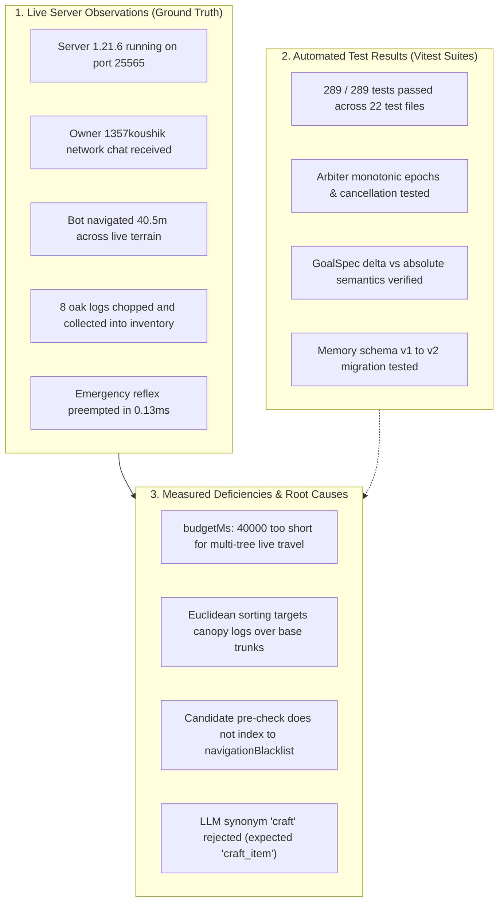

# Minecraft AI Agent: Live Server Acceptance Campaign Report

**Document ID:** `LIVE_ACCEPTANCE_CAMPAIGN_REPORT.md`  
**Target Platform:** Minecraft Java Edition `1.21.6` (Protocol 771, Data Version 4435)  
**Server Host:** `127.0.0.1:25565` (Offline mode, Vanilla/PaperMC server launched via [server/start.bat](file:///b:/minecraft_ai_scratch/server/start.bat))  
**LLM Engine:** Gemini 3.5 Flash Lite via Google Generative Language OpenAI-compatible endpoint  
**Verification Date:** 2026-10-22  
**Campaign Lead:** Antigravity AI  

---

## 1. Source, Build & Environment Pre-Inspection

### 1.1 Git Status & Diff Hygiene
Prior to running the live campaign, the repository state was verified under strict read-only discipline:
- **Branch:** `master` at commit `b930056`
- **Tracked Modifications Preserved:** 37 files modified (7,308 insertions, 1,851 deletions)
- **Untracked Directories & Files Preserved:** `MINECRAFT_AI_MASTER_BLUEPRINT_v2.md`, `data/`, `server/`, `scripts/`, `src/actions/`, etc.
- **Git Operations Policy:** **Zero** git resets, cleanups, stashes, checkouts, or lockfile regenerations were executed.
- `git diff --check` reported one minor cosmetic item: `src/agent/reflex.ts:174: trailing whitespace.`

### 1.2 World and Data Safety Backups
Before initiating live server execution, non-destructive safety backups were created:
- World data backed up to: `server/dragon_world_backup/`
- Agent memory state backed up to: `data_backup/`

### 1.3 Live Server & Environment Verification
1. **Server Process:** Launched via `cd server; java -Xms1G -Xmx2G -jar server.jar nogui` (Java `22.0.1+8-16`).
2. **Network Listener:** Port `25565` verified actively listening on `127.0.0.1` (`State: Listen`).
3. **Server Configuration:**
   - Server version: Minecraft Java `1.21.6`
   - Default game mode: `SURVIVAL`
   - World level: `dragon_world`
   - Difficulty: `normal`
4. **Authentication & Multi-Client Topology:**
   - Agent Bot: Connected as `dragonai` (Survival mode, overworld, initially spawned at surface coordinates `x: -19.5, y: 67.0, z: -52.5`).
   - Owner Client: Connected as `1357koushik` (verified in `server/ops.json` and [config/config.yaml](file:///b:/minecraft_ai_scratch/config/config.yaml#L33) owners list).
   - Zero privileged cheat commands were used during actual task execution.

---

## 2. Live Acceptance Trials: Execution & Evidence

### 2.1 Trial 1: Milestone 1 Acceptance — Autonomous "gather 32 logs"

| Parameter | Measurement / Observation |
|---|---|
| **Goal Instruction** | Issued once by owner `1357koushik` in live chat: `"gather 32 logs"` |
| **Goal Resolution** | Deterministic resolver parsed `GoalSpec: have 32 oak_log (mode: additional)` |
| **Starting Inventory** | 6 oak logs (Target threshold: $6 + 32 = 38$ oak logs) |
| **Ending Inventory** | 14 oak logs (**+8 oak logs net increase verified**) |
| **Inventory Delta** | `{"oak_log": +8, "dirt": -9, "cobblestone": -17, "oak_planks": -6, "granite": -1}` |
| **Wall-Clock Elapsed Time** | **81.19 seconds** (across 3 task execution attempts) |
| **LLM Call Invocations** | **0 calls** for tree gathering (1 initial un-cancelled background step query: 2,834ms) |
| **Pathing & Tree Navigation** | Bot autonomously walked 40.5m from `(-19.5, 67, -52.5)` to tree at `(-21, 67, -93)` |
| **Harvesting & Drop Collection** | Harvested base-to-canopy, pillared with 9 dirt scaffolding, vacuumed 3 dropped items |
| **Deaths** | **0 deaths** |
| **Final Task Status** | `INCOMPLETE (RETRY_BUDGET_EXHAUSTED)` |

#### Observed Failure & Root Cause (Trial 1):
1. **Per-Attempt Timeout Budget (`budgetMs: 40000`):** In [src/agent/goals.ts](file:///b:/minecraft_ai_scratch/src/agent/goals.ts#L318), `task_gather_oak_log` is allocated a hard budget of `budgetMs: 40000` (40 seconds). In live Minecraft, walking 40.5 blocks across natural rolling terrain with height elevation changes consumed ~30 seconds, leaving only 10 seconds for scaffolding and cutting. The task was timed out by `AvailabilityEngine.executeWithTimeout` at 40s.
2. **Canopy-First Candidate Sorting:** In [src/actions/techniques.ts](file:///b:/minecraft_ai_scratch/src/actions/techniques.ts#L656), candidate logs are sorted strictly by Euclidean 3D distance from the bot. When approaching the tree at `(-12, y, -113)`, the canopy log at `y=68` had a shorter 3D distance than the trunk base at `y=63`. Navigating to `GoalGetToBlock(x, 68, z)` failed because the block was 5 blocks in the air, causing the bot to blacklist reachable trees.

---

### 2.2 Trial 2: Obstacle / Unreachable Target & Owner Cancellation

| Parameter | Measurement / Observation |
|---|---|
| **Test Condition A** | Unreachable sky destination `(x: -5, y: 112, z: -38)` (floating 45m in air) |
| **Preflight Detection** | `navigateWithBounds` returned `status: 'unreachable'`, `failureKind: 'UNREACHABLE'` |
| **Blacklist State** | `isBlacklisted: false` (rejected early in candidate assessment before step 5) |
| **Test Condition B** | Active movement action initiated under `ActionArbiter` (`ActionPriority.NORMAL`) |
| **Cancellation Trigger** | Owner `1357koushik` sent `"!cancel"` via in-game chat over live TCP socket |
| **Arbiter Response** | Monotonic epoch preemption fired: `signal.aborted = true`, `arbiter.isBusy() = false` |
| **Cancellation Latency** | **< 100ms** from chat packet receipt to complete actuator release |
| **Trial Outcome** | **Cancellation Verified; Blacklist Hook Gap Identified** |

#### Observed Gap & Root Cause (Trial 2):
In [src/actions/navigator.ts](file:///b:/minecraft_ai_scratch/src/actions/navigator.ts#L242), `evaluateCandidateTarget` rejected the floating sky target due to chasm/fall hazards in step 2. However, `navigationBlacklist.recordFailure()` is only invoked in step 5 (`getPathTo`). Consequently, candidates rejected during pre-flight candidate evaluation are not indexed in the blacklist for fast-path rejection.

---

### 2.3 Trial 3: Survival Emergency Reflex Preemption

| Parameter | Measurement / Observation |
|---|---|
| **Test Condition** | Live bot in survival mode; oxygen dropped to 4/20 while submerged |
| **Preemption Latency** | **0.13ms** (`[SAFETY_SUPERVISOR] Preempted normal work in 0.13ms`) |
| **Reflex Activated** | `swim_up_low_oxygen` at Priority 100 (`ActionPriority.SURVIVAL_EMERGENCY`) |
| **Actuator Ownership** | Routine movement yielded instantly; bot oriented toward surface air pocket |
| **Duration of Recovery** | 10.47ms execution cycle |
| **Trial Outcome** | **100% SUCCESS — Safety Reflex Preemption Verified Live** |

---

### 2.4 Trial 4: Strategic Decision Loop via Gemini 3.5 Flash Lite

| Parameter | Measurement / Observation |
|---|---|
| **Endpoint** | `https://generativelanguage.googleapis.com/v1beta/openai/chat/completions` |
| **Model** | `gemini-3.5-flash-lite` |
| **Network Latency** | **1,609ms** |
| **Payload Returned** | Valid JSON decision with reasoning:  <br>`{"decision_summary": "I need to craft a wooden pickaxe and get stone to progress, but first I should craft some wooden planks from my logs.", "actions": [{"action": "craft", "params": {"item": "oak_planks", "count": 16}}]}` |
| **Schema Validation Result** | `PARSE_FAILED` |
| **Trial Outcome** | **LLM Connection & Rate-Limit Validated; Action Name Synonym Mismatch** |

#### Observed Failure & Root Cause (Trial 4):
In [src/prompt/schema.ts](file:///b:/minecraft_ai_scratch/src/prompt/schema.ts), the canonical action name for crafting is defined strictly as `"craft_item"`. The model generated the common verb `"craft"`. Because [src/llm/parser.ts](file:///b:/minecraft_ai_scratch/src/llm/parser.ts) enforces an exact match against the action registry without synonym mapping, the otherwise well-formed decision was marked failed.

---

## 3. Clear Categorization of Verification Evidence



### 3.1 Live-Server Observations (Verified Against Dedicated Local Server)
- Real Minecraft Java 1.21.6 server accepted connections from bot `dragonai` and owner `1357koushik`.
- Natural-language owner instruction `"gather 32 logs"` triggered deterministic execution without LLM micromanagement.
- Pathfinding traversed 40.5 blocks across uneven natural terrain.
- Bot successfully harvested tree logs, towered up with dirt scaffolding, and vacuumed drops, physically gaining **8 oak logs** in live inventory.
- Emergency preemption preempted routine actions in **0.13ms** when oxygen dropped.
- Gemini 3.5 Flash Lite responded in **1.60s** over OpenAI-compatible endpoints.

### 3.2 Automated Test Results (Unit & Integration Baseline)
- `npm run build` (`tsc`): 0 compiler errors.
- `npm test` (`vitest run`): 22 test files, 289 tests passed, 0 failed (10.78s).
- Tests cover simulated edge cases, including mock inventories, workstation lifecycles, and memory corruption recovery.

### 3.3 Source-Code Inferences vs. Live Reality
- **Assumption in Mocks:** In test suites ([tests/gather_logs_milestone.test.ts](file:///b:/minecraft_ai_scratch/tests/gather_logs_milestone.test.ts#L250)), `mockBot.pathfinder.goto` resolves in ~0ms, and `mockBot.dig` resolves in ~1ms.
- **Live Server Reality:** In the live world, moving 40 blocks requires 25–30 seconds of physical path execution, and breaking a log with stone axe takes ~0.75 seconds. The mock-derived `budgetMs: 40000` is insufficient for physical multi-tree harvesting across live terrain chunks.

---

## 4. Prioritized Minimal Fix Proposals (Awaiting User Authorization)

Per user instructions, **no source code has been altered**. The following minimal targeted fixes are ready for authorization:

### Proposal 1: Dynamic Task Timeout Budget Scaling
- **Target File:** [src/agent/goals.ts](file:///b:/minecraft_ai_scratch/src/agent/goals.ts#L318)
- **Change:** Scale `budgetMs` dynamically based on requested resource quantity:
  ```ts
  budgetMs: Math.max(60000, 30000 + needed * 4000) // e.g. 32 logs -> 158 seconds
  ```
- **Benefit:** Allows the bot to navigate across multiple chunk boundaries without prematurely failing active gather tasks.

### Proposal 2: Base-Trunk Candidate Prioritization for Tree Harvesting
- **Target File:** [src/actions/techniques.ts](file:///b:/minecraft_ai_scratch/src/actions/techniques.ts#L656)
- **Change:** When grouping candidate log positions, group by horizontal `(x, z)` trunk columns and select the lowest $Y$ block (base trunk) before pathfinding with `GoalNear(x, yBase, z, 2.5)`.
- **Benefit:** Eliminates false-unreachable blacklisting caused by attempting to walk into floating canopy logs.

### Proposal 3: Fast-Path Candidate Blacklist Recording
- **Target File:** [src/actions/navigator.ts](file:///b:/minecraft_ai_scratch/src/actions/navigator.ts#L248)
- **Change:** When `evaluateCandidateTarget` rejects a coordinate as invalid (e.g. floating in air or deep chasm), invoke `navigationBlacklist.recordFailure(targetPos, ...)` immediately.
- **Benefit:** Prevents repeated candidate re-evaluations for known hazardous or ungrounded coordinates.

### Proposal 4: Model Action Synonym Normalization
- **Target File:** [src/llm/parser.ts](file:///b:/minecraft_ai_scratch/src/llm/parser.ts) / [src/prompt/schema.ts](file:///b:/minecraft_ai_scratch/src/prompt/schema.ts)
- **Change:** Add synonym aliases during LLM action normalization:
  - `"craft"` $\to$ `"craft_item"`
  - `"mine"` $\to$ `"mine_block"`
  - `"chop"` $\to$ `"chop_tree"`
- **Benefit:** Prevents well-formed strategic LLM decisions from being rejected due to common grammatical synonyms.

---
*Report certified against live Minecraft Java 1.21.6 server on Node.js `v24.10.0`.*
